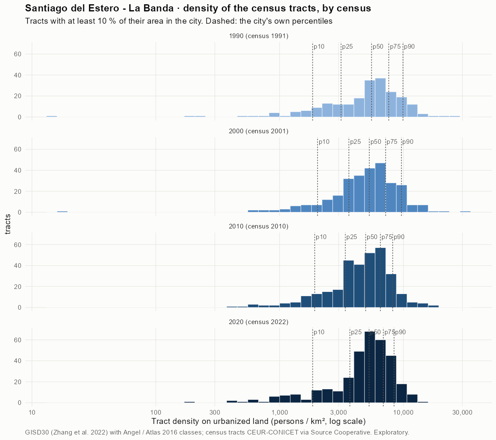
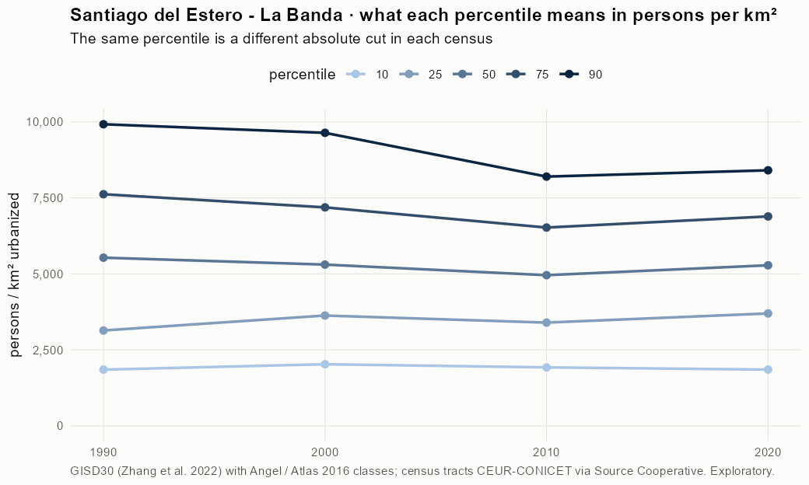
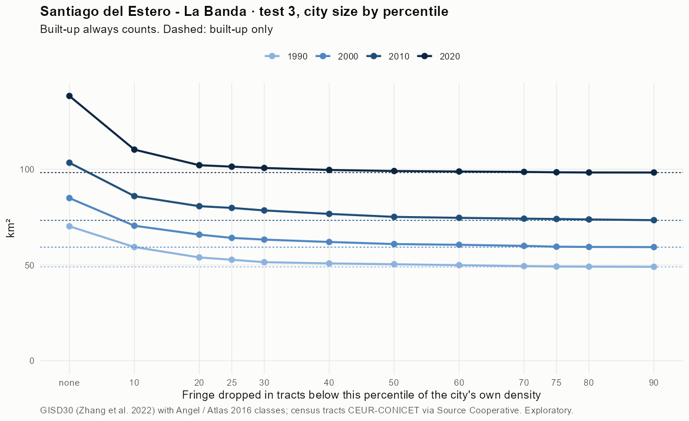
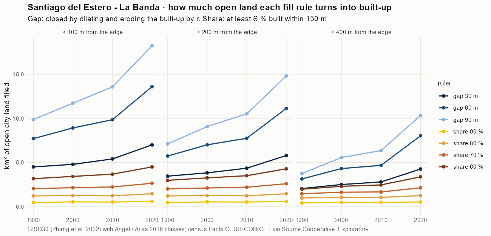
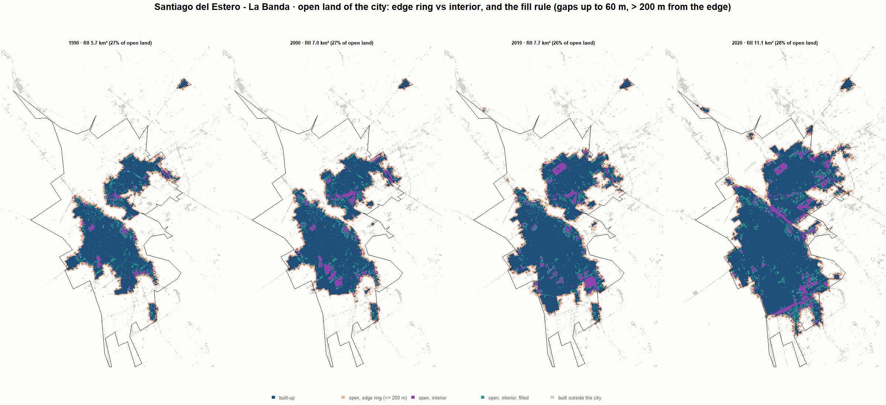
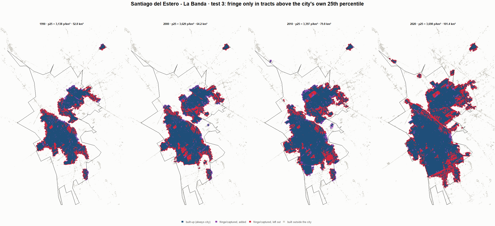

# Santiago del Estero - La Banda · relative cut (test 3) and the fill rule, 1990-2020

Exploratory. None of these numbers are project figures (they are not in `CIFRAS_CANONICAS.json`). Generated by `Rpipe/scripts/16_reglas.R` from step 11. Run of 2026-11-15. [All agglomerations](../REPORTE.md) · [methods](../../METODOS.md).

## The density of the tracts

Tracts with at least 10 % of their area in the city, and the city's own percentiles of their density on urbanized land.

| Year | Tracts | p10 | p25 | p50 | p75 | p90 |
|---|---|---|---|---|---|---|
| 1990 (census 1991) | 219 | 1,849 | 3,138 | 5,533 | 7,621 | 9,923 |
| 2000 (census 2001) | 286 | 2,027 | 3,629 | 5,306 | 7,188 | 9,641 |
| 2010 (census 2010) | 325 | 1,923 | 3,397 | 4,957 | 6,524 | 8,201 |
| 2020 (census 2022) | 341 | 1,850 | 3,698 | 5,282 | 6,890 | 8,408 |

## Test 3 · fringe only above the city's own percentile

Built-up land is always city. Fringe and captured land join only in tracts at or above percentile p of the city's own tract densities, that census.

| Percentile | 1990 cut p/km² | 2000 cut p/km² | 2010 cut p/km² | 2020 cut p/km² | 1990 km² | 2000 km² | 2010 km² | 2020 km² | 1990-2020 %/yr |
|---|---|---|---|---|---|---|---|---|---|
| none (Angel) | 0 | 0 | 0 | 0 | 70.2 | 85.0 | 103.4 | 138.2 | 2.28 |
| p10 | 1,849 | 2,027 | 1,923 | 1,850 | 59.4 | 70.5 | 86.0 | 110.2 | 2.08 |
| p20 | 2,703 | 3,124 | 3,026 | 3,289 | 54.0 | 65.9 | 80.7 | 102.1 | 2.15 |
| p25 | 3,138 | 3,629 | 3,397 | 3,698 | 52.8 | 64.2 | 79.8 | 101.4 | 2.20 |
| p30 | 3,944 | 3,855 | 3,644 | 4,171 | 51.5 | 63.3 | 78.5 | 100.7 | 2.26 |
| p40 | 4,918 | 4,526 | 4,182 | 4,747 | 50.8 | 62.0 | 76.7 | 99.6 | 2.27 |
| p50 | 5,533 | 5,306 | 4,957 | 5,282 | 50.4 | 60.9 | 75.1 | 99.1 | 2.28 |
| p60 | 6,192 | 6,012 | 5,499 | 5,835 | 49.9 | 60.6 | 74.6 | 98.8 | 2.30 |
| p70 | 6,973 | 6,767 | 6,200 | 6,610 | 49.4 | 60.0 | 74.2 | 98.6 | 2.33 |
| p75 | 7,621 | 7,188 | 6,524 | 6,890 | 49.2 | 59.6 | 74.0 | 98.4 | 2.34 |
| p80 | 8,342 | 7,736 | 6,979 | 7,367 | 49.1 | 59.4 | 73.8 | 98.3 | 2.34 |
| p90 | 9,923 | 9,641 | 8,201 | 8,408 | 49.1 | 59.4 | 73.4 | 98.3 | 2.34 |
| built only | — | — | — | — | 49.0 | 59.3 | 73.3 | 98.2 | 2.35 |

## Fill rule · open land in the centre that is probably built

An open pixel of the city (fringe or captured) farther than D from any land outside the city becomes built-up if it is a narrow gap in the built-up: closing the built-up (dilate, then erode) with a square of radius r covers it. Central rule: r = 60 m, D = 200 m; *dense* = tract at or above 500 p/km². The alternative share rule fills a pixel with at least S of the pixels within 150 m built.

| Year | Open city land km² | Interior (> 200 m) km² | Filled km² | Filled in dense tracts km² | Built-up km² | Built-up + fill km² | Persons / km² built | With fill |
|---|---|---|---|---|---|---|---|---|
| 1990 (census 1991) | 21.2 | 8.7 | 5.7 | 5.5 | 49.0 | 54.5 | 5,514 | 4,958 |
| 2000 (census 2001) | 25.6 | 12.6 | 7.0 | 6.8 | 59.3 | 66.2 | 5,663 | 5,078 |
| 2010 (census 2010) | 30.1 | 14.5 | 7.7 | 7.5 | 73.3 | 80.8 | 5,069 | 4,601 |
| 2020 (census 2022) | 40.0 | 22.4 | 11.1 | 9.3 | 98.2 | 107.5 | 4,644 | 4,243 |

**Sensitivity: km² filled by each rule** (in brackets, % of the interior open land):

| Year | Farther than | gap 30 m | gap 60 m | gap 90 m | share 60 % | share 70 % | share 80 % | share 90 % |
|---|---|---|---|---|---|---|---|---|
| 1990 | 100 m | 4.5 (37) | 7.7 (64) | 9.9 (82) | 3.2 (26) | 2.0 (17) | 1.2 (10) | 0.5 (4) |
| 1990 | 200 m | 3.4 (40) | 5.7 (66) | 7.1 (82) | 3.0 (34) | 2.0 (23) | 1.2 (14) | 0.5 (5) |
| 1990 | 400 m | 2.0 (44) | 3.1 (68) | 3.7 (82) | 2.0 (43) | 1.4 (32) | 1.0 (21) | 0.4 (9) |
| 2000 | 100 m | 4.8 (30) | 8.9 (56) | 11.7 (73) | 3.4 (21) | 2.1 (13) | 1.2 (8) | 0.5 (3) |
| 2000 | 200 m | 3.8 (30) | 7.0 (55) | 9.1 (72) | 3.3 (26) | 2.1 (17) | 1.2 (10) | 0.5 (4) |
| 2000 | 400 m | 2.5 (30) | 4.3 (52) | 5.6 (67) | 2.3 (28) | 1.6 (20) | 1.0 (13) | 0.5 (6) |
| 2010 | 100 m | 5.4 (29) | 9.9 (53) | 13.6 (73) | 3.7 (20) | 2.2 (12) | 1.2 (7) | 0.5 (3) |
| 2010 | 200 m | 4.3 (30) | 7.7 (53) | 10.5 (73) | 3.5 (24) | 2.2 (15) | 1.2 (8) | 0.5 (3) |
| 2010 | 400 m | 2.8 (30) | 4.7 (50) | 6.3 (67) | 2.4 (26) | 1.7 (18) | 1.0 (11) | 0.5 (5) |
| 2020 | 100 m | 7.0 (26) | 13.6 (50) | 18.3 (67) | 4.5 (17) | 2.6 (10) | 1.5 (5) | 0.6 (2) |
| 2020 | 200 m | 5.8 (26) | 11.1 (50) | 14.8 (66) | 4.3 (19) | 2.6 (12) | 1.4 (6) | 0.6 (3) |
| 2020 | 400 m | 4.3 (27) | 8.0 (51) | 10.3 (65) | 3.4 (21) | 2.1 (13) | 1.2 (8) | 0.5 (3) |

**Test 3 at p25 plus the central fill, without asking for a dense tract** (the fill keeps interior gaps of sparse tracts that test 3 drops):

| Year | Angel km² | Test 3 p25 km² | Test 3 + fill km² |
|---|---|---|---|
| 1990 | 70.2 | 52.8 | 56.8 |
| 2000 | 85.0 | 64.2 | 69.2 |
| 2010 | 103.4 | 79.8 | 85.5 |
| 2020 | 138.2 | 101.4 | 110.7 |

## Maps

### Edge ring, interior and fill

### Test 3 at p25

