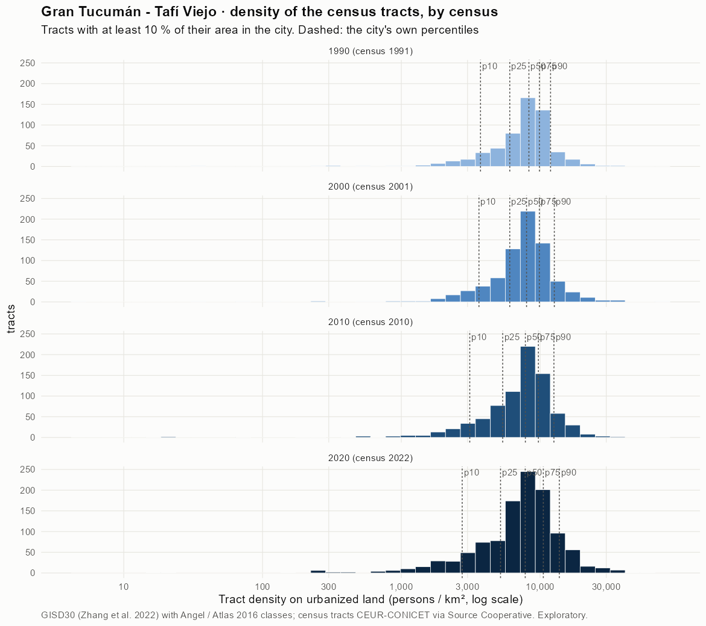
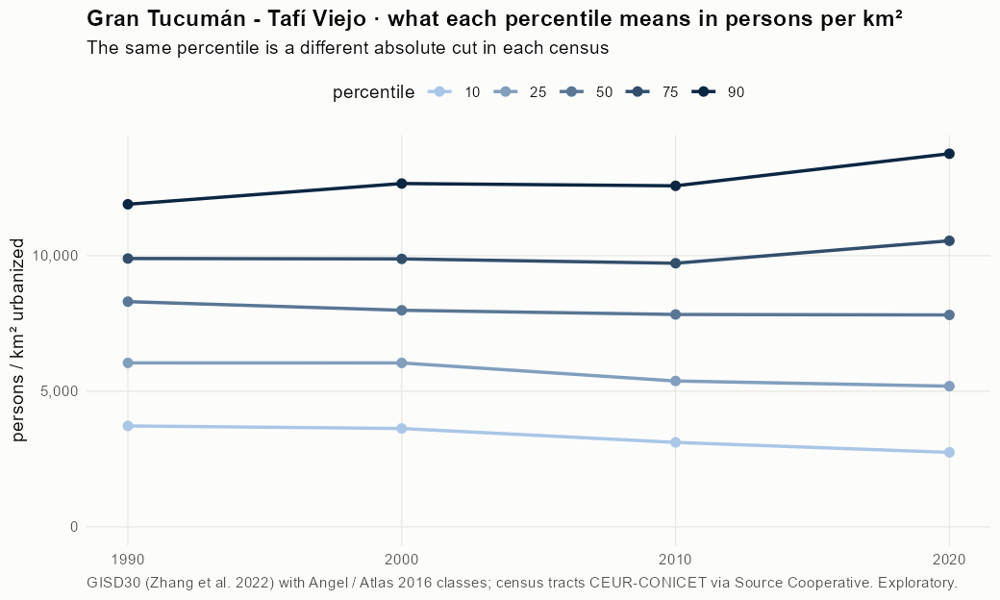
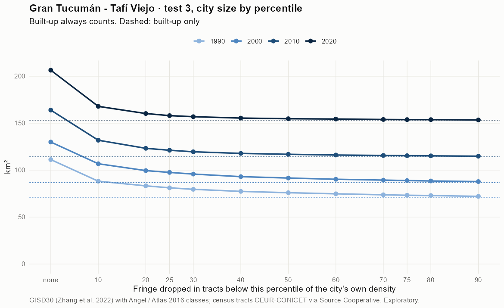
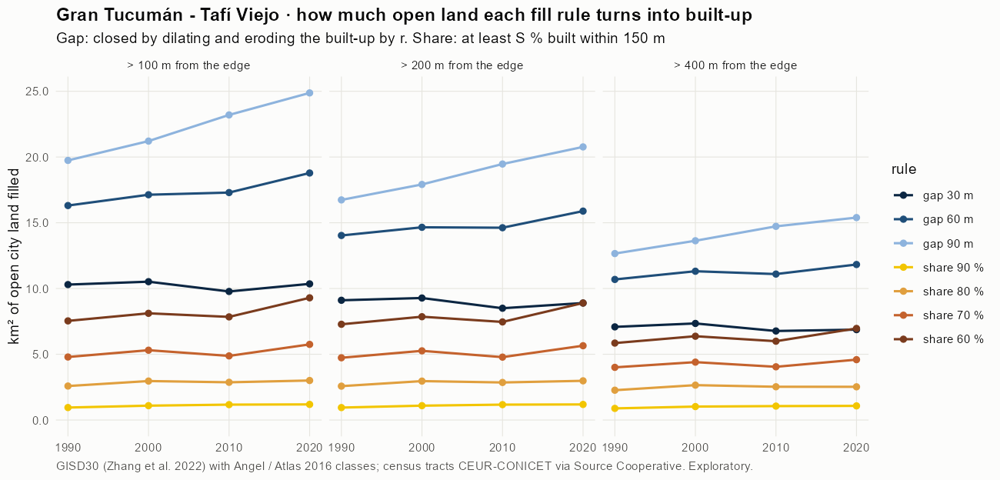
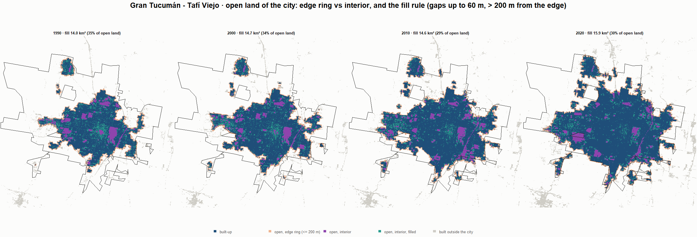
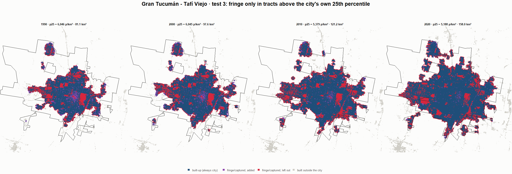

# Gran Tucumán - Tafí Viejo · relative cut (test 3) and the fill rule, 1990-2020

Exploratory. None of these numbers are project figures (they are not in `CIFRAS_CANONICAS.json`). Generated by `Rpipe/scripts/16_reglas.R` from step 11. Run of 2026-11-15. [All agglomerations](../REPORTE.md) · [methods](../../METODOS.md).

## The density of the tracts

Tracts with at least 10 % of their area in the city, and the city's own percentiles of their density on urbanized land.

| Year | Tracts | p10 | p25 | p50 | p75 | p90 |
|---|---|---|---|---|---|---|
| 1990 (census 1991) | 568 | 3,721 | 6,046 | 8,306 | 9,896 | 11,897 |
| 2000 (census 2001) | 746 | 3,626 | 6,045 | 7,987 | 9,882 | 12,662 |
| 2010 (census 2010) | 801 | 3,114 | 5,379 | 7,832 | 9,722 | 12,578 |
| 2020 (census 2022) | 1,115 | 2,746 | 5,188 | 7,815 | 10,550 | 13,762 |

## Test 3 · fringe only above the city's own percentile

Built-up land is always city. Fringe and captured land join only in tracts at or above percentile p of the city's own tract densities, that census.

| Percentile | 1990 cut p/km² | 2000 cut p/km² | 2010 cut p/km² | 2020 cut p/km² | 1990 km² | 2000 km² | 2010 km² | 2020 km² | 1990-2020 %/yr |
|---|---|---|---|---|---|---|---|---|---|
| none (Angel) | 0 | 0 | 0 | 0 | 111.2 | 129.9 | 163.9 | 206.4 | 2.08 |
| p10 | 3,721 | 3,626 | 3,114 | 2,746 | 88.2 | 106.8 | 131.8 | 167.9 | 2.17 |
| p20 | 5,425 | 5,397 | 4,744 | 4,309 | 83.2 | 99.5 | 123.2 | 160.3 | 2.21 |
| p25 | 6,046 | 6,045 | 5,379 | 5,188 | 81.1 | 97.6 | 121.2 | 158.0 | 2.25 |
| p30 | 6,596 | 6,551 | 6,148 | 5,877 | 79.6 | 95.8 | 119.5 | 156.9 | 2.29 |
| p40 | 7,570 | 7,268 | 7,136 | 6,976 | 77.3 | 93.0 | 117.8 | 155.4 | 2.35 |
| p50 | 8,306 | 7,987 | 7,832 | 7,815 | 75.9 | 91.6 | 116.9 | 154.7 | 2.40 |
| p60 | 8,958 | 8,679 | 8,532 | 8,756 | 74.8 | 90.3 | 116.1 | 154.4 | 2.45 |
| p70 | 9,536 | 9,325 | 9,344 | 9,759 | 73.7 | 89.4 | 115.6 | 153.9 | 2.48 |
| p75 | 9,896 | 9,882 | 9,722 | 10,550 | 73.2 | 88.9 | 115.4 | 153.8 | 2.51 |
| p80 | 10,252 | 10,481 | 10,436 | 11,249 | 72.9 | 88.4 | 115.2 | 153.8 | 2.52 |
| p90 | 11,897 | 12,662 | 12,578 | 13,762 | 72.1 | 87.8 | 114.8 | 153.4 | 2.55 |
| built only | — | — | — | — | 70.9 | 86.8 | 114.2 | 153.2 | 2.60 |

## Fill rule · open land in the centre that is probably built

An open pixel of the city (fringe or captured) farther than D from any land outside the city becomes built-up if it is a narrow gap in the built-up: closing the built-up (dilate, then erode) with a square of radius r covers it. Central rule: r = 60 m, D = 200 m; *dense* = tract at or above 500 p/km². The alternative share rule fills a pixel with at least S of the pixels within 150 m built.

| Year | Open city land km² | Interior (> 200 m) km² | Filled km² | Filled in dense tracts km² | Built-up km² | Built-up + fill km² | Persons / km² built | With fill |
|---|---|---|---|---|---|---|---|---|
| 1990 (census 1991) | 40.3 | 26.2 | 14.0 | 13.5 | 70.9 | 84.4 | 9,530 | 8,006 |
| 2000 (census 2001) | 43.2 | 27.2 | 14.7 | 14.4 | 86.8 | 101.2 | 9,347 | 8,016 |
| 2010 (census 2010) | 49.8 | 30.5 | 14.6 | 14.1 | 114.2 | 128.2 | 7,794 | 6,940 |
| 2020 (census 2022) | 53.2 | 30.8 | 15.9 | 14.2 | 153.2 | 167.4 | 6,884 | 6,301 |

**Sensitivity: km² filled by each rule** (in brackets, % of the interior open land):

| Year | Farther than | gap 30 m | gap 60 m | gap 90 m | share 60 % | share 70 % | share 80 % | share 90 % |
|---|---|---|---|---|---|---|---|---|
| 1990 | 100 m | 10.3 (35) | 16.3 (55) | 19.7 (66) | 7.5 (25) | 4.8 (16) | 2.6 (9) | 0.9 (3) |
| 1990 | 200 m | 9.1 (35) | 14.0 (54) | 16.7 (64) | 7.3 (28) | 4.7 (18) | 2.6 (10) | 0.9 (4) |
| 1990 | 400 m | 7.1 (34) | 10.7 (51) | 12.7 (60) | 5.9 (28) | 4.0 (19) | 2.3 (11) | 0.9 (4) |
| 2000 | 100 m | 10.5 (34) | 17.1 (55) | 21.2 (68) | 8.1 (26) | 5.3 (17) | 3.0 (10) | 1.1 (4) |
| 2000 | 200 m | 9.3 (34) | 14.7 (54) | 17.9 (66) | 7.9 (29) | 5.3 (19) | 3.0 (11) | 1.1 (4) |
| 2000 | 400 m | 7.3 (34) | 11.3 (52) | 13.6 (63) | 6.4 (29) | 4.4 (20) | 2.7 (12) | 1.0 (5) |
| 2010 | 100 m | 9.8 (28) | 17.3 (49) | 23.2 (66) | 7.8 (22) | 4.9 (14) | 2.9 (8) | 1.2 (3) |
| 2010 | 200 m | 8.5 (28) | 14.6 (48) | 19.5 (64) | 7.5 (24) | 4.8 (16) | 2.9 (9) | 1.2 (4) |
| 2010 | 400 m | 6.8 (28) | 11.1 (45) | 14.7 (60) | 6.0 (24) | 4.0 (17) | 2.5 (10) | 1.1 (4) |
| 2020 | 100 m | 10.4 (29) | 18.8 (53) | 24.9 (70) | 9.3 (26) | 5.8 (16) | 3.0 (8) | 1.2 (3) |
| 2020 | 200 m | 8.9 (29) | 15.9 (52) | 20.8 (67) | 8.9 (29) | 5.7 (18) | 3.0 (10) | 1.2 (4) |
| 2020 | 400 m | 6.9 (28) | 11.8 (49) | 15.4 (63) | 7.0 (29) | 4.6 (19) | 2.5 (10) | 1.1 (4) |

**Test 3 at p25 plus the central fill, without asking for a dense tract** (the fill keeps interior gaps of sparse tracts that test 3 drops):

| Year | Angel km² | Test 3 p25 km² | Test 3 + fill km² |
|---|---|---|---|
| 1990 | 111.2 | 81.1 | 88.7 |
| 2000 | 129.9 | 97.6 | 106.2 |
| 2010 | 163.9 | 121.2 | 131.8 |
| 2020 | 206.4 | 158.0 | 171.2 |

## Maps

### Edge ring, interior and fill

### Test 3 at p25

