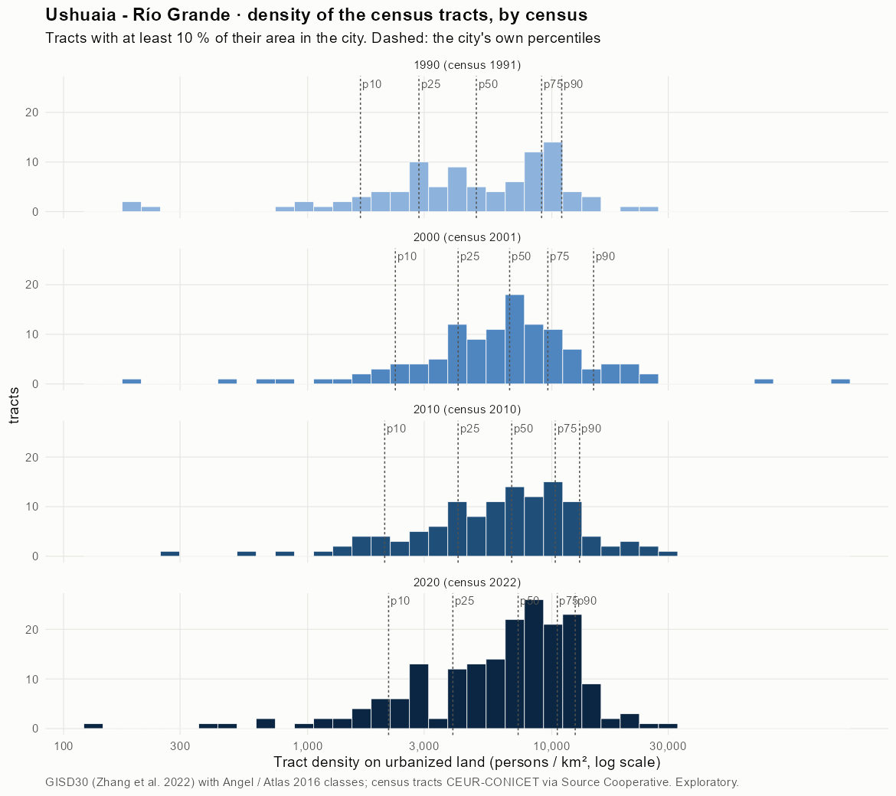
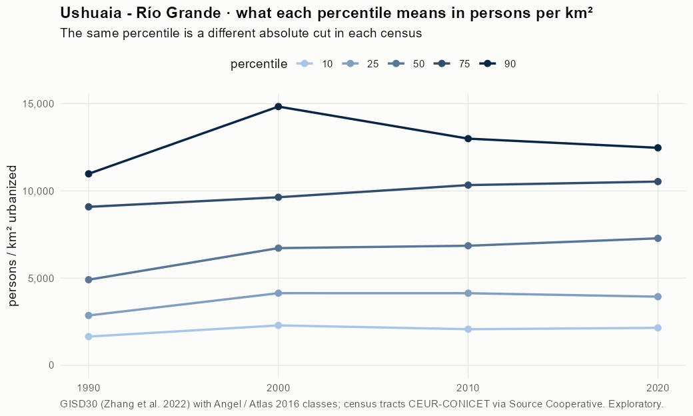
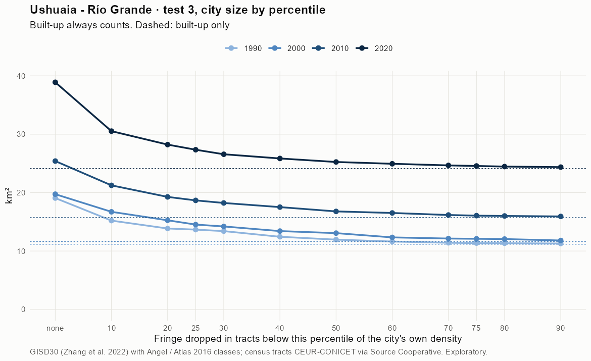
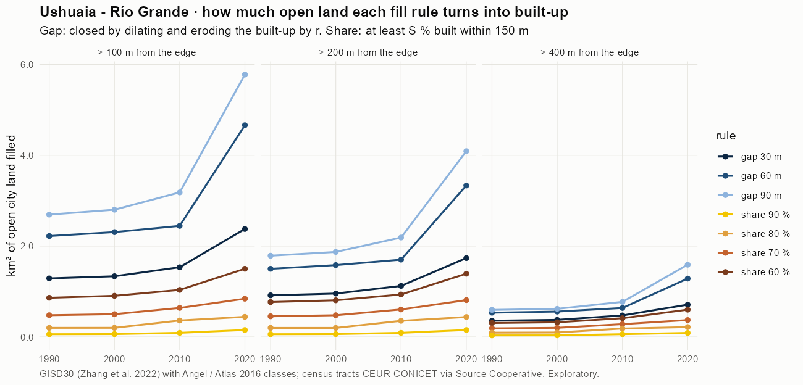
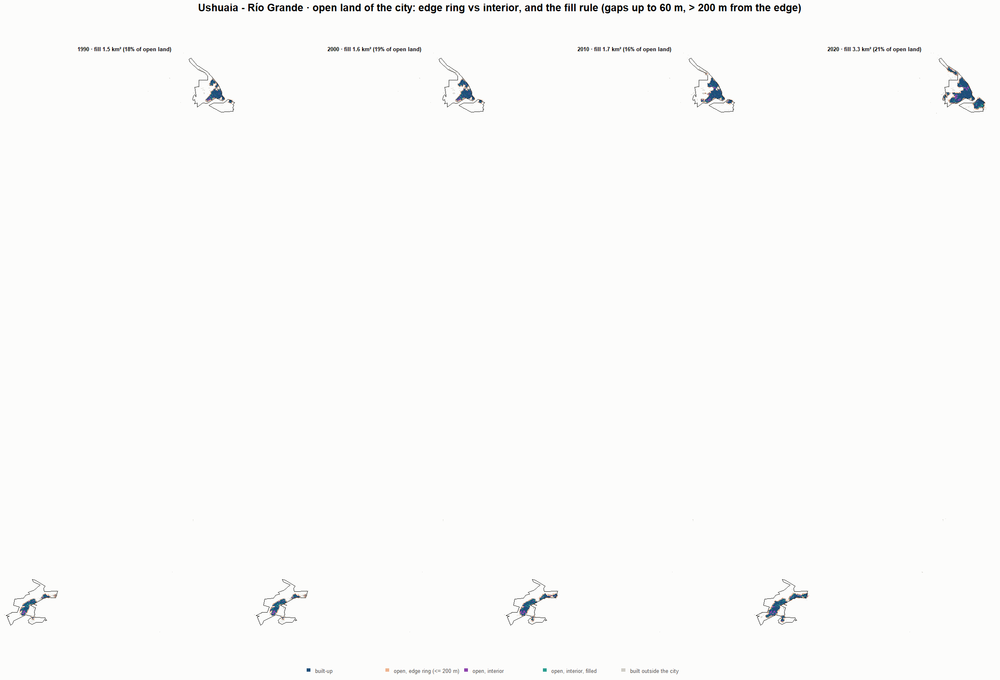
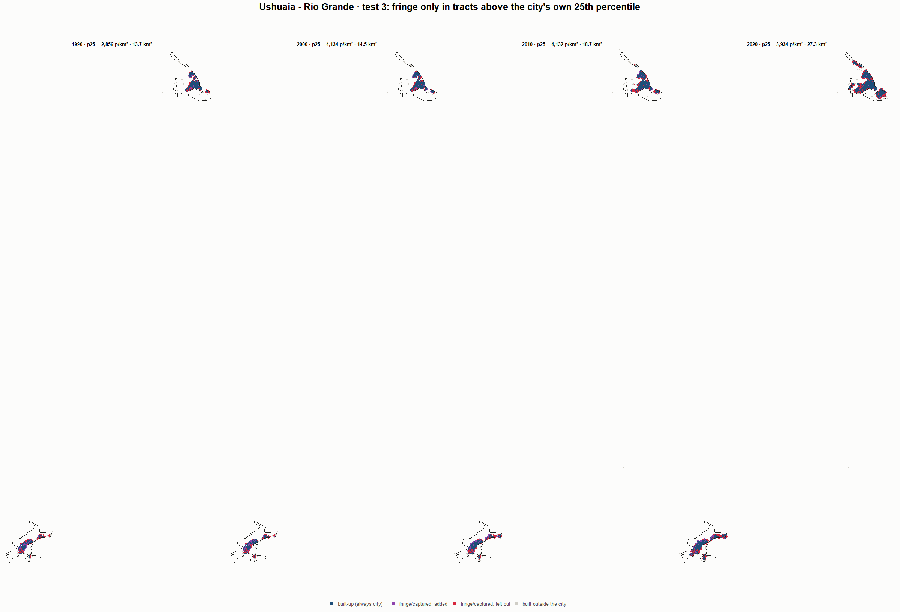

# Ushuaia - Río Grande · relative cut (test 3) and the fill rule, 1990-2020

Exploratory. None of these numbers are project figures (they are not in `CIFRAS_CANONICAS.json`). Generated by `Rpipe/scripts/16_reglas.R` from step 11. Run of 2026-11-15. [All agglomerations](../REPORTE.md) · [methods](../../METODOS.md).

## The density of the tracts

Tracts with at least 10 % of their area in the city, and the city's own percentiles of their density on urbanized land.

| Year | Tracts | p10 | p25 | p50 | p75 | p90 |
|---|---|---|---|---|---|---|
| 1990 (census 1991) | 94 | 1,645 | 2,856 | 4,907 | 9,085 | 10,981 |
| 2000 (census 2001) | 119 | 2,286 | 4,134 | 6,719 | 9,636 | 14,837 |
| 2010 (census 2010) | 122 | 2,068 | 4,132 | 6,854 | 10,333 | 12,998 |
| 2020 (census 2022) | 188 | 2,145 | 3,934 | 7,279 | 10,535 | 12,473 |

## Test 3 · fringe only above the city's own percentile

Built-up land is always city. Fringe and captured land join only in tracts at or above percentile p of the city's own tract densities, that census.

| Percentile | 1990 cut p/km² | 2000 cut p/km² | 2010 cut p/km² | 2020 cut p/km² | 1990 km² | 2000 km² | 2010 km² | 2020 km² | 1990-2020 %/yr |
|---|---|---|---|---|---|---|---|---|---|
| none (Angel) | 0 | 0 | 0 | 0 | 19.1 | 19.7 | 25.4 | 38.9 | 2.40 |
| p10 | 1,645 | 2,286 | 2,068 | 2,145 | 15.2 | 16.7 | 21.2 | 30.5 | 2.35 |
| p20 | 2,433 | 3,724 | 3,448 | 3,103 | 13.9 | 15.3 | 19.3 | 28.2 | 2.40 |
| p25 | 2,856 | 4,134 | 4,132 | 3,934 | 13.7 | 14.5 | 18.7 | 27.3 | 2.34 |
| p30 | 2,994 | 4,494 | 4,350 | 4,701 | 13.4 | 14.2 | 18.2 | 26.6 | 2.31 |
| p40 | 3,924 | 5,756 | 5,670 | 5,918 | 12.4 | 13.4 | 17.5 | 25.8 | 2.47 |
| p50 | 4,907 | 6,719 | 6,854 | 7,279 | 12.0 | 13.1 | 16.8 | 25.2 | 2.52 |
| p60 | 7,437 | 7,517 | 7,809 | 8,335 | 11.6 | 12.3 | 16.5 | 24.9 | 2.58 |
| p70 | 8,025 | 9,154 | 9,358 | 9,541 | 11.4 | 12.1 | 16.2 | 24.7 | 2.60 |
| p75 | 9,085 | 9,636 | 10,333 | 10,535 | 11.4 | 12.1 | 16.1 | 24.6 | 2.60 |
| p80 | 9,509 | 10,690 | 10,963 | 11,182 | 11.3 | 12.0 | 16.0 | 24.5 | 2.60 |
| p90 | 10,981 | 14,837 | 12,998 | 12,473 | 11.3 | 11.8 | 15.9 | 24.4 | 2.60 |
| built only | — | — | — | — | 11.1 | 11.6 | 15.7 | 24.1 | 2.61 |

## Fill rule · open land in the centre that is probably built

An open pixel of the city (fringe or captured) farther than D from any land outside the city becomes built-up if it is a narrow gap in the built-up: closing the built-up (dilate, then erode) with a square of radius r covers it. Central rule: r = 60 m, D = 200 m; *dense* = tract at or above 500 p/km². The alternative share rule fills a pixel with at least S of the pixels within 150 m built.

| Year | Open city land km² | Interior (> 200 m) km² | Filled km² | Filled in dense tracts km² | Built-up km² | Built-up + fill km² | Persons / km² built | With fill |
|---|---|---|---|---|---|---|---|---|
| 1990 (census 1991) | 8.3 | 2.5 | 1.5 | 1.4 | 11.1 | 12.5 | 6,070 | 5,404 |
| 2000 (census 2001) | 8.5 | 2.6 | 1.6 | 1.5 | 11.6 | 13.1 | 8,436 | 7,485 |
| 2010 (census 2010) | 10.3 | 3.2 | 1.7 | 1.7 | 15.7 | 17.4 | 7,543 | 6,816 |
| 2020 (census 2022) | 15.8 | 5.9 | 3.3 | 3.0 | 24.1 | 27.1 | 7,105 | 6,322 |

**Sensitivity: km² filled by each rule** (in brackets, % of the interior open land):

| Year | Farther than | gap 30 m | gap 60 m | gap 90 m | share 60 % | share 70 % | share 80 % | share 90 % |
|---|---|---|---|---|---|---|---|---|
| 1990 | 100 m | 1.3 (35) | 2.2 (60) | 2.7 (72) | 0.9 (23) | 0.5 (13) | 0.2 (5) | 0.1 (2) |
| 1990 | 200 m | 0.9 (36) | 1.5 (59) | 1.8 (71) | 0.8 (30) | 0.5 (18) | 0.2 (8) | 0.1 (2) |
| 1990 | 400 m | 0.4 (39) | 0.5 (58) | 0.6 (65) | 0.3 (33) | 0.2 (21) | 0.1 (10) | 0.0 (4) |
| 2000 | 100 m | 1.3 (35) | 2.3 (60) | 2.8 (73) | 0.9 (24) | 0.5 (13) | 0.2 (5) | 0.1 (2) |
| 2000 | 200 m | 1.0 (36) | 1.6 (60) | 1.9 (71) | 0.8 (31) | 0.5 (18) | 0.2 (8) | 0.1 (2) |
| 2000 | 400 m | 0.4 (39) | 0.6 (59) | 0.6 (65) | 0.3 (34) | 0.2 (21) | 0.1 (10) | 0.0 (4) |
| 2010 | 100 m | 1.5 (33) | 2.4 (52) | 3.2 (68) | 1.0 (22) | 0.6 (14) | 0.4 (8) | 0.1 (2) |
| 2010 | 200 m | 1.1 (35) | 1.7 (53) | 2.2 (68) | 0.9 (29) | 0.6 (19) | 0.4 (11) | 0.1 (3) |
| 2010 | 400 m | 0.5 (37) | 0.6 (50) | 0.8 (61) | 0.4 (33) | 0.3 (22) | 0.2 (15) | 0.1 (5) |
| 2020 | 100 m | 2.4 (29) | 4.7 (56) | 5.8 (70) | 1.5 (18) | 0.8 (10) | 0.4 (5) | 0.2 (2) |
| 2020 | 200 m | 1.7 (29) | 3.3 (57) | 4.1 (69) | 1.4 (24) | 0.8 (14) | 0.4 (7) | 0.2 (3) |
| 2020 | 400 m | 0.7 (26) | 1.3 (48) | 1.6 (59) | 0.6 (22) | 0.4 (14) | 0.2 (8) | 0.1 (3) |

**Test 3 at p25 plus the central fill, without asking for a dense tract** (the fill keeps interior gaps of sparse tracts that test 3 drops):

| Year | Angel km² | Test 3 p25 km² | Test 3 + fill km² |
|---|---|---|---|
| 1990 | 19.1 | 13.7 | 14.2 |
| 2000 | 19.7 | 14.5 | 15.1 |
| 2010 | 25.4 | 18.7 | 19.5 |
| 2020 | 38.9 | 27.3 | 29.3 |

## Maps

### Edge ring, interior and fill

### Test 3 at p25

