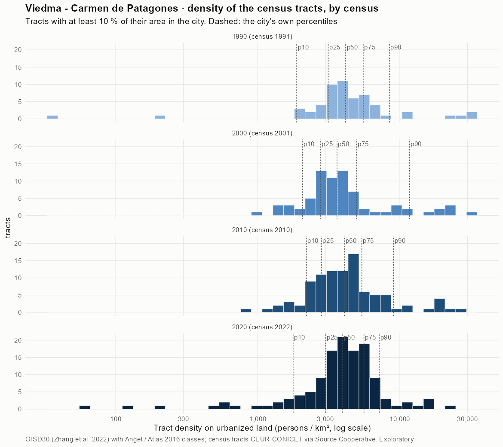
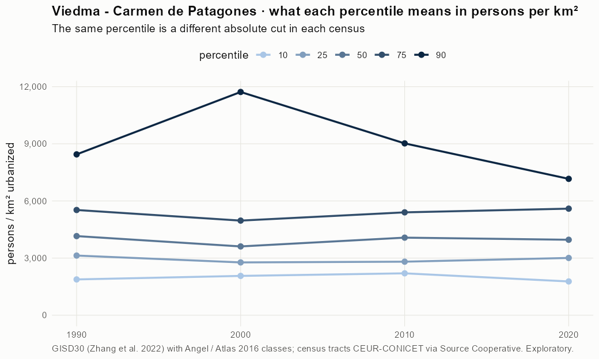
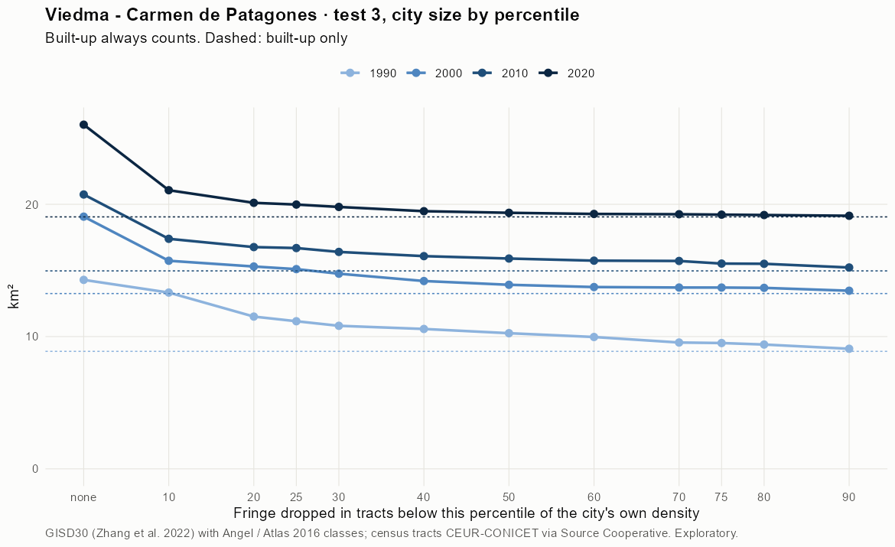
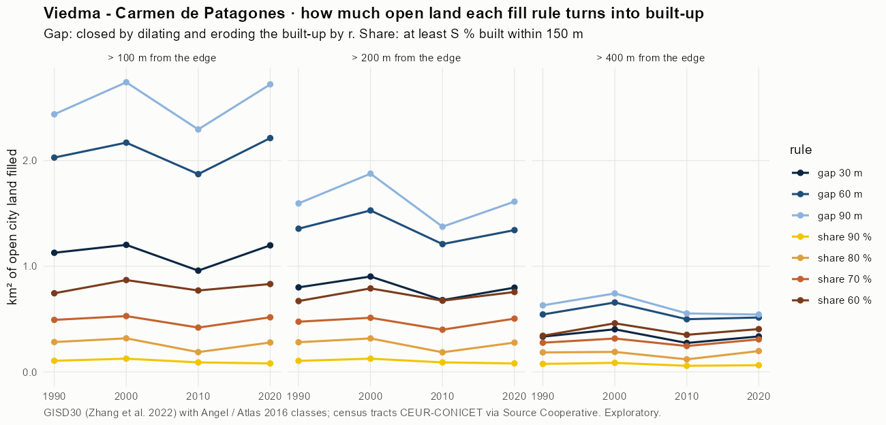
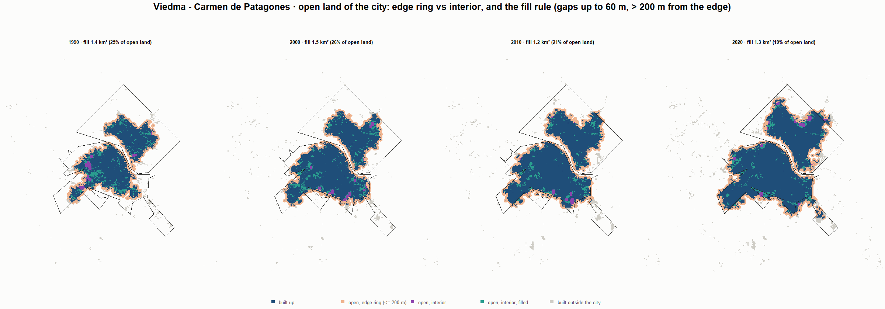
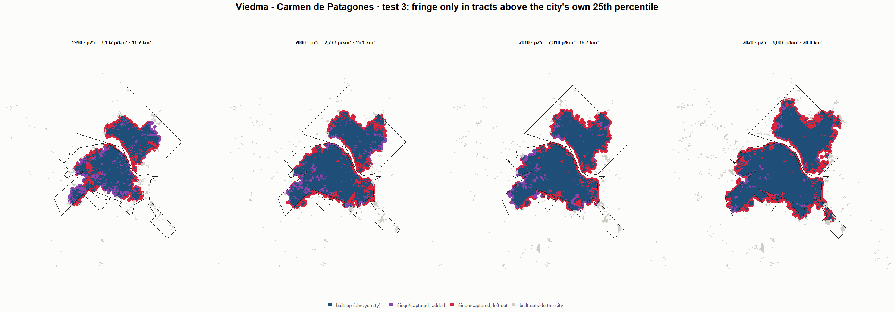

# Viedma - Carmen de Patagones · relative cut (test 3) and the fill rule, 1990-2020

Exploratory. None of these numbers are project figures (they are not in `CIFRAS_CANONICAS.json`). Generated by `Rpipe/scripts/16_reglas.R` from step 11. Run of 2026-11-15. [All agglomerations](../REPORTE.md) · [methods](../../METODOS.md).

## The density of the tracts

Tracts with at least 10 % of their area in the city, and the city's own percentiles of their density on urbanized land.

| Year | Tracts | p10 | p25 | p50 | p75 | p90 |
|---|---|---|---|---|---|---|
| 1990 (census 1991) | 59 | 1,879 | 3,132 | 4,154 | 5,525 | 8,445 |
| 2000 (census 2001) | 74 | 2,064 | 2,773 | 3,612 | 4,968 | 11,722 |
| 2010 (census 2010) | 96 | 2,199 | 2,810 | 4,073 | 5,401 | 9,022 |
| 2020 (census 2022) | 126 | 1,773 | 3,007 | 3,962 | 5,595 | 7,161 |

## Test 3 · fringe only above the city's own percentile

Built-up land is always city. Fringe and captured land join only in tracts at or above percentile p of the city's own tract densities, that census.

| Percentile | 1990 cut p/km² | 2000 cut p/km² | 2010 cut p/km² | 2020 cut p/km² | 1990 km² | 2000 km² | 2010 km² | 2020 km² | 1990-2020 %/yr |
|---|---|---|---|---|---|---|---|---|---|
| none (Angel) | 0 | 0 | 0 | 0 | 14.3 | 19.1 | 20.7 | 26.0 | 2.02 |
| p10 | 1,879 | 2,064 | 2,199 | 1,773 | 13.3 | 15.7 | 17.4 | 21.1 | 1.54 |
| p20 | 2,908 | 2,643 | 2,649 | 2,745 | 11.5 | 15.3 | 16.8 | 20.1 | 1.88 |
| p25 | 3,132 | 2,773 | 2,810 | 3,007 | 11.2 | 15.1 | 16.7 | 20.0 | 1.96 |
| p30 | 3,273 | 2,951 | 3,020 | 3,207 | 10.8 | 14.8 | 16.4 | 19.8 | 2.04 |
| p40 | 3,595 | 3,362 | 3,584 | 3,709 | 10.6 | 14.2 | 16.1 | 19.5 | 2.06 |
| p50 | 4,154 | 3,612 | 4,073 | 3,962 | 10.3 | 13.9 | 15.9 | 19.4 | 2.14 |
| p60 | 4,337 | 4,078 | 4,536 | 4,642 | 10.0 | 13.7 | 15.7 | 19.3 | 2.22 |
| p70 | 5,180 | 4,709 | 5,081 | 5,265 | 9.6 | 13.7 | 15.7 | 19.2 | 2.36 |
| p75 | 5,525 | 4,968 | 5,401 | 5,595 | 9.5 | 13.7 | 15.5 | 19.2 | 2.37 |
| p80 | 5,881 | 5,990 | 6,194 | 5,841 | 9.4 | 13.7 | 15.5 | 19.2 | 2.41 |
| p90 | 8,445 | 11,722 | 9,022 | 7,161 | 9.1 | 13.5 | 15.2 | 19.1 | 2.52 |
| built only | — | — | — | — | 8.9 | 13.3 | 15.0 | 19.0 | 2.58 |

## Fill rule · open land in the centre that is probably built

An open pixel of the city (fringe or captured) farther than D from any land outside the city becomes built-up if it is a narrow gap in the built-up: closing the built-up (dilate, then erode) with a square of radius r covers it. Central rule: r = 60 m, D = 200 m; *dense* = tract at or above 500 p/km². The alternative share rule fills a pixel with at least S of the pixels within 150 m built.

| Year | Open city land km² | Interior (> 200 m) km² | Filled km² | Filled in dense tracts km² | Built-up km² | Built-up + fill km² | Persons / km² built | With fill |
|---|---|---|---|---|---|---|---|---|
| 1990 (census 1991) | 5.4 | 1.7 | 1.4 | 1.3 | 8.9 | 10.2 | 6,525 | 5,671 |
| 2000 (census 2001) | 5.8 | 1.9 | 1.5 | 1.5 | 13.3 | 14.7 | 4,946 | 4,446 |
| 2010 (census 2010) | 5.8 | 1.4 | 1.2 | 1.2 | 15.0 | 16.2 | 4,970 | 4,600 |
| 2020 (census 2022) | 7.0 | 1.8 | 1.3 | 1.2 | 19.0 | 20.2 | 4,422 | 4,169 |

**Sensitivity: km² filled by each rule** (in brackets, % of the interior open land):

| Year | Farther than | gap 30 m | gap 60 m | gap 90 m | share 60 % | share 70 % | share 80 % | share 90 % |
|---|---|---|---|---|---|---|---|---|
| 1990 | 100 m | 1.1 (41) | 2.0 (74) | 2.4 (89) | 0.7 (27) | 0.5 (18) | 0.3 (10) | 0.1 (4) |
| 1990 | 200 m | 0.8 (46) | 1.4 (78) | 1.6 (92) | 0.7 (39) | 0.5 (28) | 0.3 (16) | 0.1 (6) |
| 1990 | 400 m | 0.3 (47) | 0.5 (77) | 0.6 (89) | 0.3 (48) | 0.3 (39) | 0.2 (26) | 0.1 (11) |
| 2000 | 100 m | 1.2 (42) | 2.2 (75) | 2.7 (95) | 0.9 (30) | 0.5 (18) | 0.3 (11) | 0.1 (4) |
| 2000 | 200 m | 0.9 (48) | 1.5 (81) | 1.9 (100) | 0.8 (42) | 0.5 (27) | 0.3 (17) | 0.1 (7) |
| 2000 | 400 m | 0.4 (54) | 0.7 (88) | 0.7 (100) | 0.5 (62) | 0.3 (42) | 0.2 (25) | 0.1 (11) |
| 2010 | 100 m | 1.0 (38) | 1.9 (75) | 2.3 (91) | 0.8 (31) | 0.4 (17) | 0.2 (7) | 0.1 (4) |
| 2010 | 200 m | 0.7 (48) | 1.2 (85) | 1.4 (96) | 0.7 (47) | 0.4 (28) | 0.2 (13) | 0.1 (6) |
| 2010 | 400 m | 0.3 (49) | 0.5 (90) | 0.6 (100) | 0.4 (63) | 0.2 (44) | 0.1 (21) | 0.1 (10) |
| 2020 | 100 m | 1.2 (38) | 2.2 (71) | 2.7 (87) | 0.8 (27) | 0.5 (17) | 0.3 (9) | 0.1 (3) |
| 2020 | 200 m | 0.8 (45) | 1.3 (76) | 1.6 (92) | 0.8 (43) | 0.5 (29) | 0.3 (16) | 0.1 (5) |
| 2020 | 400 m | 0.3 (62) | 0.5 (94) | 0.5 (100) | 0.4 (74) | 0.3 (56) | 0.2 (36) | 0.1 (12) |

**Test 3 at p25 plus the central fill, without asking for a dense tract** (the fill keeps interior gaps of sparse tracts that test 3 drops):

| Year | Angel km² | Test 3 p25 km² | Test 3 + fill km² |
|---|---|---|---|
| 1990 | 14.3 | 11.2 | 11.6 |
| 2000 | 19.1 | 15.1 | 15.8 |
| 2010 | 20.7 | 16.7 | 17.3 |
| 2020 | 26.0 | 20.0 | 20.8 |

## Maps

### Edge ring, interior and fill

### Test 3 at p25

