# Angel / Atlas 2016 metrics on GISD30 · 31 Argentine agglomerations, 1990-2020

Exploratory. None of these numbers are project figures (they are not in `CIFRAS_CANONICAS.json`). The whole report, every number and every label included, is generated by `Rpipe/scripts/06_reporte.R` from `Rpipe/outputs/angel/resumen.csv` (step 04). Run of 2026-11-03.

**Question:** how is each agglomeration growing, and how much does it change the picture to count the *fringe open space* (the 100 m ring of unbuilt land around urban and suburban built-up) as part of the city?

## Contents

1. [Summary](#summary)
2. [Method](#method)
3. [Argentina](#argentina)
4. [Agglomerations](#agglomerations): [Bahía Blanca - Cerri](#bahía-blanca---cerri) · [Comodoro Rivadavia - Rada Tilly](#comodoro-rivadavia---rada-tilly) · [Concordia](#concordia) · [Corrientes](#corrientes) · [Formosa](#formosa) · [Gran Buenos Aires](#gran-buenos-aires) · [Gran Catamarca](#gran-catamarca) · [Gran Córdoba](#gran-córdoba) · [Gran La Plata](#gran-la-plata) · [Gran Mendoza](#gran-mendoza) · [Gran Paraná](#gran-paraná) · [Gran Resistencia](#gran-resistencia) · [Gran Rosario](#gran-rosario) · [Gran San Juan](#gran-san-juan) · [Gran Santa Fe](#gran-santa-fe) · [Gran Tucumán - Tafí Viejo](#gran-tucumán---tafí-viejo) · [Jujuy - Palpalá](#jujuy---palpalá) · [La Rioja](#la-rioja) · [Mar del Plata - Batán](#mar-del-plata---batán) · [Neuquén - Plottier](#neuquén---plottier) · [Posadas](#posadas) · [Rawson - Trelew](#rawson---trelew) · [Río Cuarto](#río-cuarto) · [Río Gallegos](#río-gallegos) · [Salta](#salta) · [San Luis - El Chorrillo](#san-luis---el-chorrillo) · [San Nicolás - Villa Constitución](#san-nicolás---villa-constitución) · [Santa Rosa - Toay](#santa-rosa---toay) · [Santiago del Estero - La Banda](#santiago-del-estero---la-banda) · [Ushuaia - Río Grande](#ushuaia---río-grande) · [Viedma - Carmen de Patagones](#viedma---carmen-de-patagones)

## Summary

Across the 31 agglomerations, built-up land inside the urban extent grew from 2,625 km² in 1990 to 4,915 km² in 2020 (2.11 % a year); without Gran Buenos Aires, from 1,343 to 2,970 km² (2.68 % a year). The fringe open space is 28.0 % of the total urban extent in 2020, and between 21.8 % and 39.8 % city by city. Counting it adds 28-66 % to the area of each city, but moves its 1990-2020 growth rate by less than 0.2 points a year in 15 of the 31.

## Method

### Data

- **GISD30** (Zhang et al. 2022, *Earth System Science Data* 14:1831-1856, CC BY 4.0): global impervious surface at 30 m from Landsat. Each pixel stores the period of its first detection: 0 never, 1 before 1985, 2-8 five-year periods 1985-2020. The record is cumulative: a pixel never stops being built.
- **Decades** (`01_gisd30_decadas.R`): built-up by 1990 = values 1-2, by 2000 = 1-4, by 2010 = 1-6, by 2020 = 1-8.
- **Agglomerate perimeters** (`07_limites_aglomerados.R`): the analysis perimeter of the *Bolsones de pobreza* project, i.e. the EPH agglomerate plus the continuous 2022 city that spills over it, simplified to about 200 m.
- **Boxes** (`cajas.md`): the perimeter's bounding box plus 10 km on every side, so the 1 km² neighbourhood never runs out of data at the edge of the city. Salta and Gran Tucumán use hand-drawn boxes that also cover the whole perimeter.
- Each box is reprojected to its UTM zone at 30 m (nearest neighbour) so that distances are metric.
- **Grid**: 17 agglomerations were cut on the grid of their Landsat composite (`04_angel_atlas.R`) and 14 directly with their box (`04b_angel_sin_landsat.R`). Landsat is only a grid template, never an input to the classes, and the composite has the same box, so the two grids differ by a fraction of a pixel at the edge. On the box grid: Gran Buenos Aires, Gran Mendoza, Gran Paraná, Gran Resistencia, Gran San Juan, La Rioja, Posadas, Rawson - Trelew, Río Cuarto, Río Gallegos, San Luis - El Chorrillo, San Nicolás - Villa Constitución, Santa Rosa - Toay, Santiago del Estero - La Banda.

### Classes

Each 30 m pixel looks at the circle of 1 km² around it (radius 564 m) and the share of that circle that is built-up. Rural cut used here: **0.25** (Atlas 2016 edition).

| Value | Class | Rule | In the urban extent? |
|---|---|---|---|
| 0 | rural open space | not built-up, none of the below | no |
| 1 | urban built-up | built-up, circle > 50 % built | yes |
| 2 | suburban built-up | built-up, circle 25-50 % built | yes |
| 3 | rural built-up | built-up, circle < 25 % built | no |
| 4 | fringe open space | not built-up, within 100 m of urban or suburban built-up | yes |
| 5 | captured open space | open patch (4-connected) under 200 ha, fully enclosed, not touching the box edge | yes |

**Urban extent** = urban + suburban + fringe + captured.

#### How the fringe is drawn

A 100 m circle on the 30 m grid is centred on every urban and suburban pixel; every pixel that is not built-up and falls inside one of those circles is fringe. On the grid the circle reaches 3 pixels straight out (90 m) and 85-95 m on the diagonals. Rural built-up pixels do not make fringe. Captured open space is assigned after the fringe, so the two never overlap.

Because each built edge brings its own ring, the fringe grows with the *length of the city's edge*, not with its area: fragmented cities carry the most fringe, and a city that builds on its old fringe loses fringe as it grows.

### "The city"

Inside each box, the city is the set of urban-extent patches (8-connected) that touch the agglomerate perimeter. A town inside the box that never touches the perimeter is left out; the two cities of a two-city agglomerate (Ushuaia and Río Grande, Viedma and Carmen de Patagones) count together.

When one patch touches the perimeters of two agglomerates, each of its pixels goes to the nearer perimeter. Without that rule the patch would count twice. Of the 31 agglomerates, it applies only to Gran Buenos Aires and Gran La Plata, whose built-up areas join (checked on the 2020 extent); patches that are not shared are not affected.

### Metrics

| Metric | Definition |
|---|---|
| built-up | built-up pixels inside the city's urban extent |
| saturation | built-up / urban extent |
| openness | average unbuilt share of the 1 km² circle around the city's urban and suburban pixels |
| fringe share | fringe open space / urban extent |
| growth | annual compound rate, (x1 / x0)^(1 / years) - 1 |
| project footprint | the *Bolsones de pobreza* definition (Angel, Parent & Civco 2007; rural cut 0.10): built-up with ≥ 10 % of its circle built, plus unbuilt pixels with > 50 % built around them or within 100 m of that built-up; patches touching the perimeter |

### Rules used to describe the cities

- **Pace** (built-up growth 1990-2020 per year): very fast ≥ 4 %, fast ≥ 2.5 %, moderate ≥ 1.5 %, slow < 1.5 %.
- **Shape** (saturation change 1990-2020): filling in ≥ +0.03, spreading out ≤ -0.03, stable in between.
- **Check**: built-up growth ≥ 4 % a year is flagged for review against GHSL or imagery.

### Caveats

- **GISD30 is the only input.** Its 1985-2000 detection is the weakest of the series (few Landsat 5 scenes), so part of the post-2000 acceleration may come from the data. In arid cities bare soil is read as impervious surface; very fast growth in the arid west and northwest should be checked against GHSL or imagery before being used.
- **Water counts as open space.** GISD30 has no water mask, so riverbanks and coasts next to the city become fringe or captured open space. The Atlas removes water from open space; this pipeline does not yet.
- **The perimeter is simplified** to about 200 m. It decides which patches are "the city"; it is not used to cut pixels.
- **Proximity is not reported**: measured to the centroid it is meaningless for multi-part agglomerates.
- **Rural cut**: the Atlas 2016 edition puts suburban at 25-50 %; the *Bolsones de pobreza* project uses the 2007-2010 definition (rural below 10 %), so its footprint is larger than the extent measured here.
- **No density yet**: it needs census population per tract.

### Pipeline (`Rpipe/scripts/`)

| Step | Script | What it does |
|---|---|---|
| 00 | `00_gisd30_descarga.R` | GISD30 tiles for Argentina (Zenodo, md5 checked) |
| 01 | `01_gisd30_decadas.R` | eight five-year epochs to four cumulative decades |
| 02 | `02_landsat_bbox.R` | Landsat composite of each box (grid template for 04) |
| 03 | `03_ghsl_built_s.R` | GHSL built-up surface, to compare with GISD30 |
| 04 | `04_angel_atlas.R` | Angel classes and metrics per decade |
| 04b | `04b_angel_sin_landsat.R` | the same as 04, cutting GISD30 with the box instead of the Landsat grid (no step 02 needed) |
| 05 | `05_per_muni.R` | runs 02 + 04 for a list of agglomerations from `Rpipe/cajas.md` |
| 06 | `06_reporte.R` | this report |
| 07 | `07_limites_aglomerados.R` | agglomerate perimeters and boxes to `Rpipe/raw/boundaries/aglomerados.gpkg` |

## Argentina

### Totals

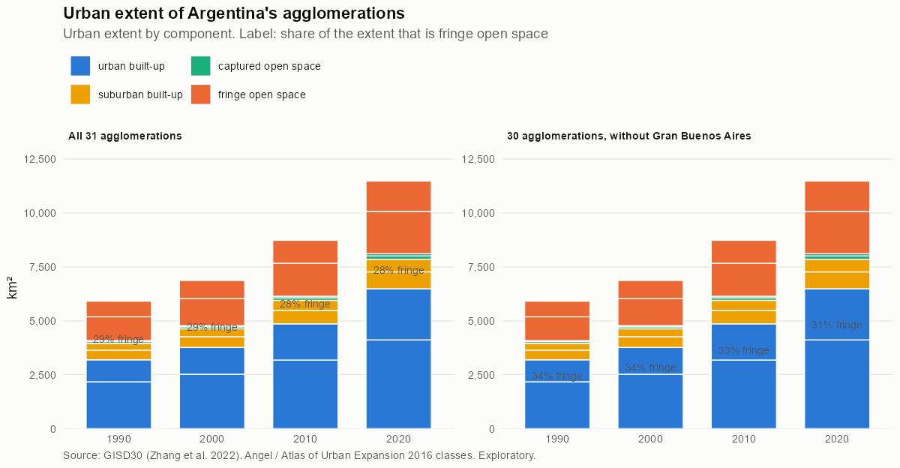

#### All 31 agglomerations (km²)

|  | urban | suburban | captured | fringe | extent | % fringe | built-up |
|---|---|---|---|---|---|---|---|
| 1990 | 2,172.4 | 443.8 | 84.1 | 1,107.0 | 3,807.3 | 29.1 | 2,624.7 |
| 2000 | 2,522.3 | 500.8 | 92.8 | 1,254.1 | 4,370.0 | 28.7 | 3,032.6 |
| 2010 | 3,181.8 | 623.3 | 118.6 | 1,527.0 | 5,450.8 | 28.0 | 3,817.2 |
| 2020 | 4,116.5 | 782.6 | 153.9 | 1,961.0 | 7,013.9 | 28.0 | 4,914.7 |

#### 30 agglomerations, without Gran Buenos Aires (km²)

|  | urban | suburban | captured | fringe | extent | % fringe | built-up |
|---|---|---|---|---|---|---|---|
| 1990 | 1,019.9 | 317.7 | 44.0 | 721.6 | 2,103.2 | 34.3 | 1,343.4 |
| 2000 | 1,241.9 | 364.7 | 53.5 | 840.6 | 2,500.8 | 33.6 | 1,613.3 |
| 2010 | 1,679.0 | 466.1 | 71.5 | 1,067.5 | 3,284.1 | 32.5 | 2,153.6 |
| 2020 | 2,372.0 | 586.2 | 102.6 | 1,406.1 | 4,466.9 | 31.5 | 2,969.7 |

Annual growth 1990-2020: built-up 2.11 %, extent without fringe 2.11 %, extent with fringe 2.06 % (all 31); 2.68, 2.69 and 2.54 % without Gran Buenos Aires.

### How each agglomeration is growing

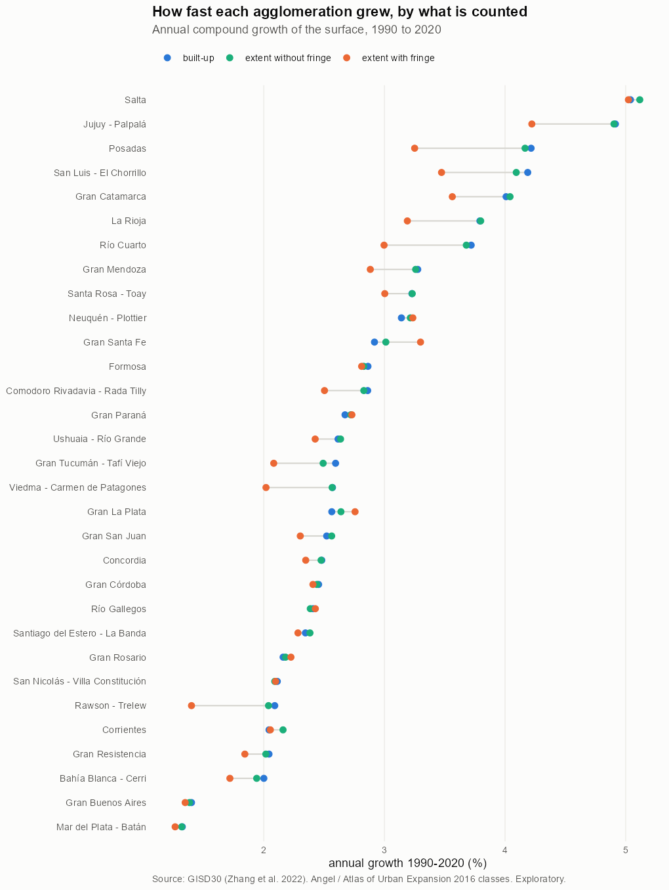

| Pace | Agglomerations |
|---|---|
| **very fast** | [Gran Catamarca](#gran-catamarca), [Jujuy - Palpalá](#jujuy---palpalá), [Posadas](#posadas), [Salta](#salta), [San Luis - El Chorrillo](#san-luis---el-chorrillo) |
| **fast** | [Comodoro Rivadavia - Rada Tilly](#comodoro-rivadavia---rada-tilly), [Formosa](#formosa), [Gran La Plata](#gran-la-plata), [Gran Mendoza](#gran-mendoza), [Gran Paraná](#gran-paraná), [Gran San Juan](#gran-san-juan), [Gran Santa Fe](#gran-santa-fe), [Gran Tucumán - Tafí Viejo](#gran-tucumán---tafí-viejo), [La Rioja](#la-rioja), [Neuquén - Plottier](#neuquén---plottier), [Río Cuarto](#río-cuarto), [Santa Rosa - Toay](#santa-rosa---toay), [Ushuaia - Río Grande](#ushuaia---río-grande), [Viedma - Carmen de Patagones](#viedma---carmen-de-patagones) |
| **moderate** | [Bahía Blanca - Cerri](#bahía-blanca---cerri), [Concordia](#concordia), [Corrientes](#corrientes), [Gran Córdoba](#gran-córdoba), [Gran Resistencia](#gran-resistencia), [Gran Rosario](#gran-rosario), [Rawson - Trelew](#rawson---trelew), [Río Gallegos](#río-gallegos), [San Nicolás - Villa Constitución](#san-nicolás---villa-constitución), [Santiago del Estero - La Banda](#santiago-del-estero---la-banda) |
| **slow** | [Gran Buenos Aires](#gran-buenos-aires), [Mar del Plata - Batán](#mar-del-plata---batán) |

| Shape | Agglomerations |
|---|---|
| **filling in** | [Bahía Blanca - Cerri](#bahía-blanca---cerri), [Comodoro Rivadavia - Rada Tilly](#comodoro-rivadavia---rada-tilly), [Gran Catamarca](#gran-catamarca), [Gran Mendoza](#gran-mendoza), [Gran Resistencia](#gran-resistencia), [Gran San Juan](#gran-san-juan), [Gran Tucumán - Tafí Viejo](#gran-tucumán---tafí-viejo), [Jujuy - Palpalá](#jujuy---palpalá), [La Rioja](#la-rioja), [Posadas](#posadas), [Rawson - Trelew](#rawson---trelew), [Río Cuarto](#río-cuarto), [San Luis - El Chorrillo](#san-luis---el-chorrillo), [Santa Rosa - Toay](#santa-rosa---toay), [Ushuaia - Río Grande](#ushuaia---río-grande), [Viedma - Carmen de Patagones](#viedma---carmen-de-patagones) |
| **stable** | [Concordia](#concordia), [Corrientes](#corrientes), [Formosa](#formosa), [Gran Buenos Aires](#gran-buenos-aires), [Gran Córdoba](#gran-córdoba), [Gran Paraná](#gran-paraná), [Gran Rosario](#gran-rosario), [Mar del Plata - Batán](#mar-del-plata---batán), [Neuquén - Plottier](#neuquén---plottier), [Río Gallegos](#río-gallegos), [Salta](#salta), [San Nicolás - Villa Constitución](#san-nicolás---villa-constitución), [Santiago del Estero - La Banda](#santiago-del-estero---la-banda) |
| **spreading out** | [Gran La Plata](#gran-la-plata), [Gran Santa Fe](#gran-santa-fe) |

**To check** (built-up ≥ 4 % a year, see the caveats): [Gran Catamarca](#gran-catamarca), [Jujuy - Palpalá](#jujuy---palpalá), [Posadas](#posadas), [Salta](#salta), [San Luis - El Chorrillo](#san-luis---el-chorrillo).

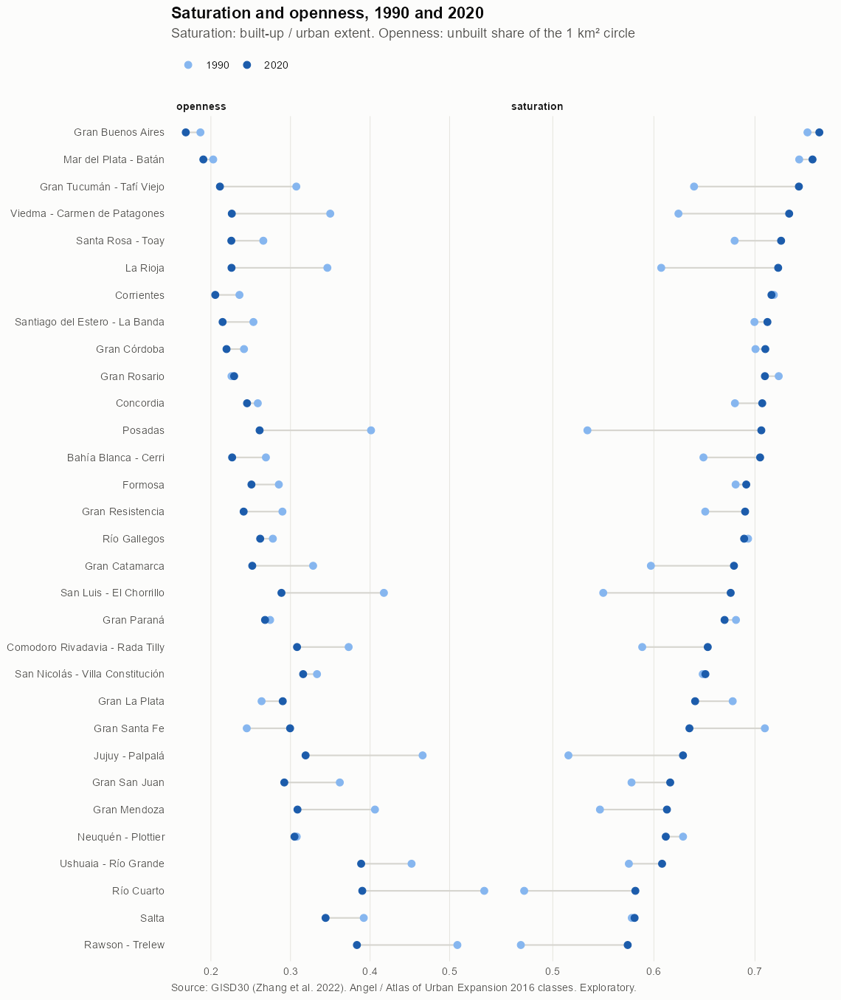

### How much the fringe open space matters

#### On the size of the city: a lot

In 2020 the fringe is between 21.8 % and 39.8 % of the urban extent; counting it adds 28-66 % to the area of everything else. Anything divided by the urban extent (population density, share of the city in a given condition) moves by that much depending on whether the fringe is in.

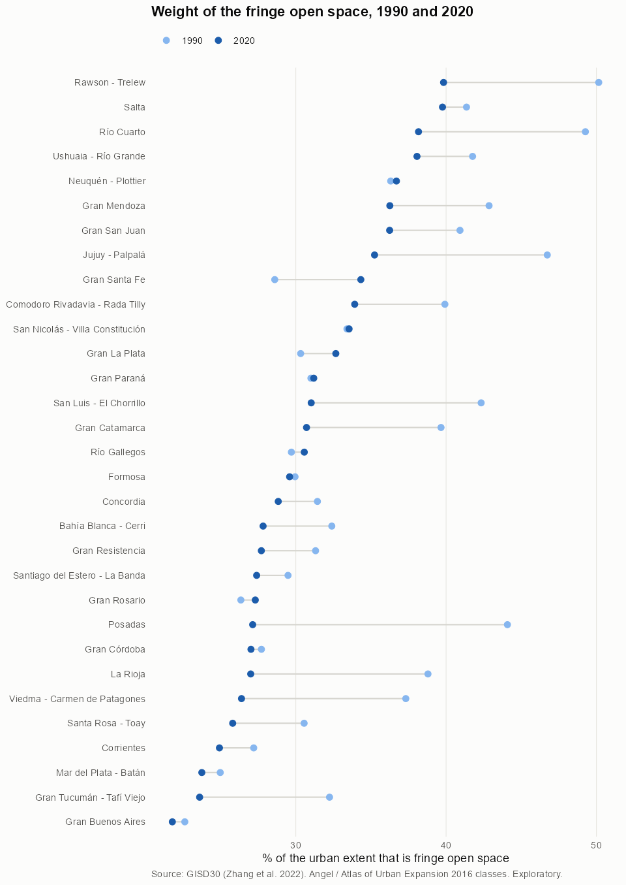

#### On growth: little in most, a lot in a few

Counting the fringe moves the 1990-2020 growth rate by less than 0.2 points a year in 15 of the 31 agglomerations. It lowers growth most where the city fills in its old fringe ([Posadas](#posadas), [Río Cuarto](#río-cuarto), [Jujuy - Palpalá](#jujuy---palpalá)) and raises it where new scattered patches add new fringe ([Gran Santa Fe](#gran-santa-fe), [Gran La Plata](#gran-la-plata), [Gran Rosario](#gran-rosario)).

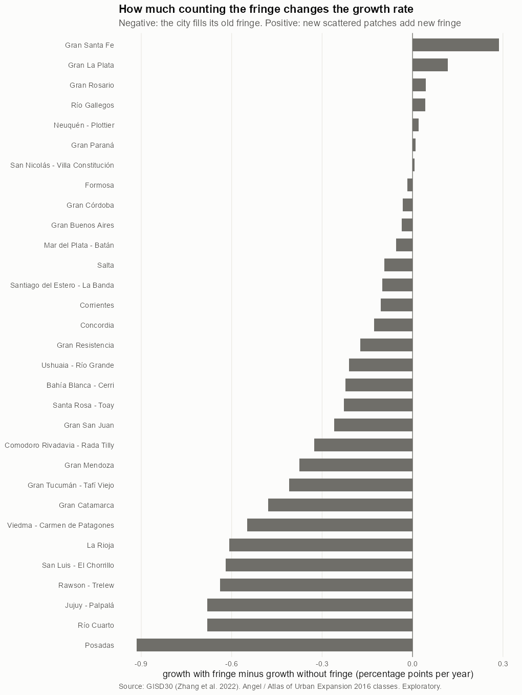

### All agglomerations

Growth in % per year, 1990-2020. Extent in km², 2020.

| Agglomeration | Province | extent 2020 | built-up | without fringe | with fringe | difference | % fringe 2020 | saturation | pace | shape |
|---|---|---|---|---|---|---|---|---|---|---|
| [Bahía Blanca - Cerri](#bahía-blanca---cerri) | Buenos Aires | 152.3 | 2.00 | 1.94 | 1.72 | -0.22 | 27.8 | 0.65 → 0.71 | moderate | filling in |
| [Comodoro Rivadavia - Rada Tilly](#comodoro-rivadavia---rada-tilly) | Chubut | 86.0 | 2.86 | 2.83 | 2.50 | -0.33 | 33.9 | 0.59 → 0.65 | fast | filling in |
| [Concordia](#concordia) | Entre Ríos | 44.1 | 2.48 | 2.48 | 2.35 | -0.13 | 28.8 | 0.68 → 0.71 | moderate | stable |
| [Corrientes](#corrientes) | Corrientes | 79.4 | 2.04 | 2.16 | 2.05 | -0.10 | 24.9 | 0.72 → 0.72 | moderate | stable |
| [Formosa](#formosa) | Formosa | 74.6 | 2.86 | 2.83 | 2.81 | -0.02 | 29.6 | 0.68 → 0.69 | fast | stable |
| [Gran Buenos Aires](#gran-buenos-aires) | Buenos Aires, Ciudad de Buenos Aires | 2,547.0 | 1.40 | 1.38 | 1.35 | -0.04 | 21.8 | 0.75 → 0.76 | slow | stable |
| [Gran Catamarca](#gran-catamarca) | Catamarca | 76.8 | 4.01 | 4.04 | 3.56 | -0.48 | 30.7 | 0.60 → 0.68 | very fast | filling in |
| [Gran Córdoba](#gran-córdoba) | Córdoba | 426.4 | 2.45 | 2.44 | 2.41 | -0.03 | 27.0 | 0.70 → 0.71 | moderate | stable |
| [Gran La Plata](#gran-la-plata) | Buenos Aires | 384.5 | 2.56 | 2.64 | 2.76 | +0.12 | 32.7 | 0.68 → 0.64 | fast | spreading out |
| [Gran Mendoza](#gran-mendoza) | Mendoza | 328.6 | 3.28 | 3.26 | 2.88 | -0.38 | 36.3 | 0.55 → 0.61 | fast | filling in |
| [Gran Paraná](#gran-paraná) | Entre Ríos | 94.7 | 2.67 | 2.72 | 2.73 | +0.01 | 31.2 | 0.68 → 0.67 | fast | stable |
| [Gran Resistencia](#gran-resistencia) | Chaco | 122.9 | 2.04 | 2.02 | 1.84 | -0.17 | 27.7 | 0.65 → 0.69 | moderate | filling in |
| [Gran Rosario](#gran-rosario) | Santa Fe | 355.7 | 2.16 | 2.18 | 2.23 | +0.04 | 27.3 | 0.72 → 0.71 | moderate | stable |
| [Gran San Juan](#gran-san-juan) | San Juan | 212.8 | 2.52 | 2.56 | 2.30 | -0.26 | 36.2 | 0.58 → 0.62 | fast | filling in |
| [Gran Santa Fe](#gran-santa-fe) | Santa Fe | 174.2 | 2.92 | 3.01 | 3.30 | +0.29 | 34.3 | 0.71 → 0.64 | fast | spreading out |
| [Gran Tucumán - Tafí Viejo](#gran-tucumán---tafí-viejo) | Tucumán | 206.4 | 2.60 | 2.49 | 2.08 | -0.41 | 23.6 | 0.64 → 0.74 | fast | filling in |
| [Jujuy - Palpalá](#jujuy---palpalá) | Jujuy | 81.4 | 4.91 | 4.90 | 4.22 | -0.68 | 35.2 | 0.52 → 0.63 | very fast | filling in |
| [La Rioja](#la-rioja) | La Rioja | 75.1 | 3.79 | 3.80 | 3.19 | -0.61 | 27.0 | 0.61 → 0.72 | fast | filling in |
| [Mar del Plata - Batán](#mar-del-plata---batán) | Buenos Aires | 178.2 | 1.32 | 1.32 | 1.27 | -0.05 | 23.7 | 0.74 → 0.76 | slow | stable |
| [Neuquén - Plottier](#neuquén---plottier) | Neuquén, Río Negro | 241.1 | 3.14 | 3.21 | 3.24 | +0.02 | 36.7 | 0.63 → 0.61 | fast | stable |
| [Posadas](#posadas) | Misiones | 105.6 | 4.22 | 4.17 | 3.25 | -0.92 | 27.1 | 0.53 → 0.71 | very fast | filling in |
| [Rawson - Trelew](#rawson---trelew) | Chubut | 231.2 | 2.09 | 2.04 | 1.40 | -0.64 | 39.8 | 0.47 → 0.57 | moderate | filling in |
| [Río Cuarto](#río-cuarto) | Córdoba | 57.9 | 3.72 | 3.68 | 3.00 | -0.68 | 38.2 | 0.47 → 0.58 | fast | filling in |
| [Río Gallegos](#río-gallegos) | Santa Cruz | 33.9 | 2.41 | 2.39 | 2.43 | +0.04 | 30.6 | 0.69 → 0.69 | moderate | stable |
| [Salta](#salta) | Salta | 249.9 | 5.04 | 5.12 | 5.02 | -0.09 | 39.8 | 0.58 → 0.58 | very fast | stable |
| [San Luis - El Chorrillo](#san-luis---el-chorrillo) | San Luis | 64.0 | 4.19 | 4.09 | 3.47 | -0.62 | 31.0 | 0.55 → 0.68 | very fast | filling in |
| [San Nicolás - Villa Constitución](#san-nicolás---villa-constitución) | Buenos Aires, Santa Fe | 73.7 | 2.11 | 2.09 | 2.10 | +0.01 | 33.5 | 0.65 → 0.65 | moderate | stable |
| [Santa Rosa - Toay](#santa-rosa---toay) | La Pampa | 51.5 | 3.23 | 3.23 | 3.00 | -0.23 | 25.8 | 0.68 → 0.73 | fast | filling in |
| [Santiago del Estero - La Banda](#santiago-del-estero---la-banda) | Santiago del Estero | 138.2 | 2.35 | 2.38 | 2.28 | -0.10 | 27.4 | 0.70 → 0.71 | moderate | stable |
| [Ushuaia - Río Grande](#ushuaia---río-grande) | Tierra del Fuego | 39.9 | 2.62 | 2.64 | 2.43 | -0.21 | 38.1 | 0.58 → 0.61 | fast | filling in |
| [Viedma - Carmen de Patagones](#viedma---carmen-de-patagones) | Buenos Aires, Río Negro | 26.0 | 2.57 | 2.57 | 2.02 | -0.55 | 26.4 | 0.62 → 0.73 | fast | filling in |

## Agglomerations

### Bahía Blanca - Cerri

Province: Buenos Aires.

Built-up land in the city's urban extent grew from **59.3 km²** in 1990 to **107.4 km²** in 2020, **2.00 % a year** (pace: **moderate**). The urban extent went from 91.3 to 152.3 km². Saturation moved from 0.65 to 0.71 (shape: **filling in**).

The fringe open space was 32.4 % of the urban extent in 1990 and 27.8 % in 2020; in 2020 it adds 39 % to the rest of the extent. Counting it changes the 1990-2020 growth rate from 1.94 % to 1.72 % a year (-0.22 points).

- The perimeter has 2 parts; patches touching any of them count as the city.

#### Growth by class

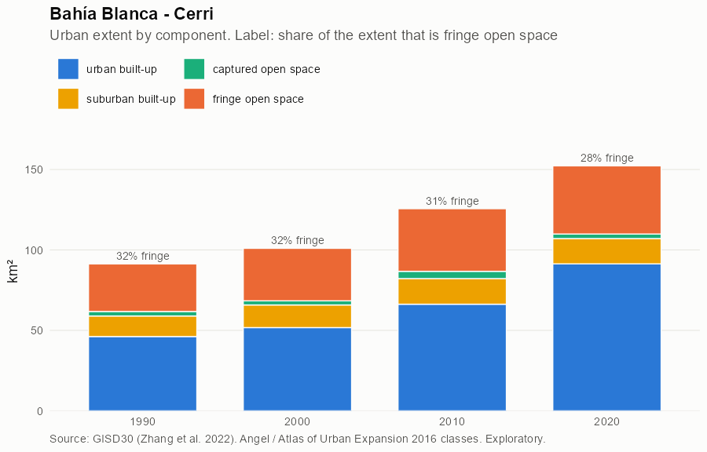

|  | urban | suburban | captured | fringe | extent | % fringe | built-up | saturation | openness | project footprint |
|---|---|---|---|---|---|---|---|---|---|---|
| 1990 | 46.2 | 12.8 | 2.8 | 29.6 | 91.3 | 32.4 | 59.3 | 0.65 | 0.27 | 116.9 |
| 2000 | 51.7 | 14.1 | 2.6 | 32.6 | 101.0 | 32.3 | 66.0 | 0.65 | 0.27 | 128.1 |
| 2010 | 66.3 | 15.9 | 4.5 | 38.9 | 125.6 | 31.0 | 82.7 | 0.66 | 0.26 | 147.0 |
| 2020 | 91.3 | 15.7 | 2.8 | 42.4 | 152.3 | 27.8 | 107.4 | 0.71 | 0.23 | 168.0 |

km². Rural built-up and rural open space lie outside the urban extent; they appear on the maps.

#### Growth by decade

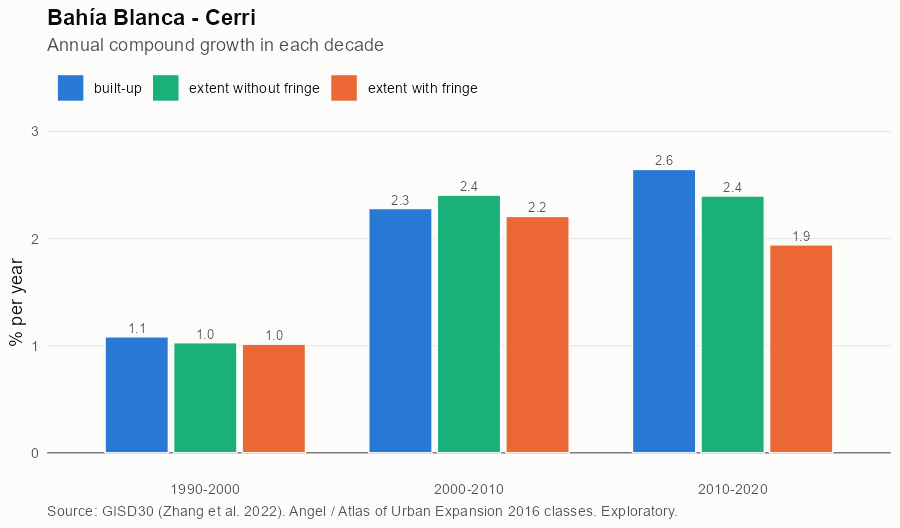

| Decade | built-up | extent without fringe | extent with fringe |
|---|---|---|---|
| 1990-2000 | 1.08 | 1.03 | 1.01 |
| 2000-2010 | 2.28 | 2.41 | 2.21 |
| 2010-2020 | 2.65 | 2.40 | 1.94 |

% per year.

#### Maps

<table>
<tr><td><a href="img/maps/bahia_blanca_1990.png">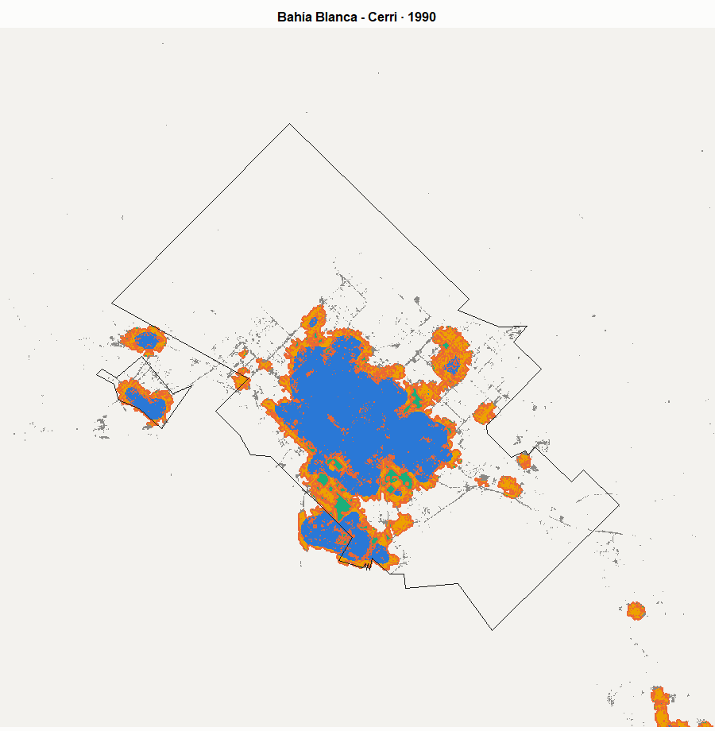</a></td><td><a href="img/maps/bahia_blanca_2000.png">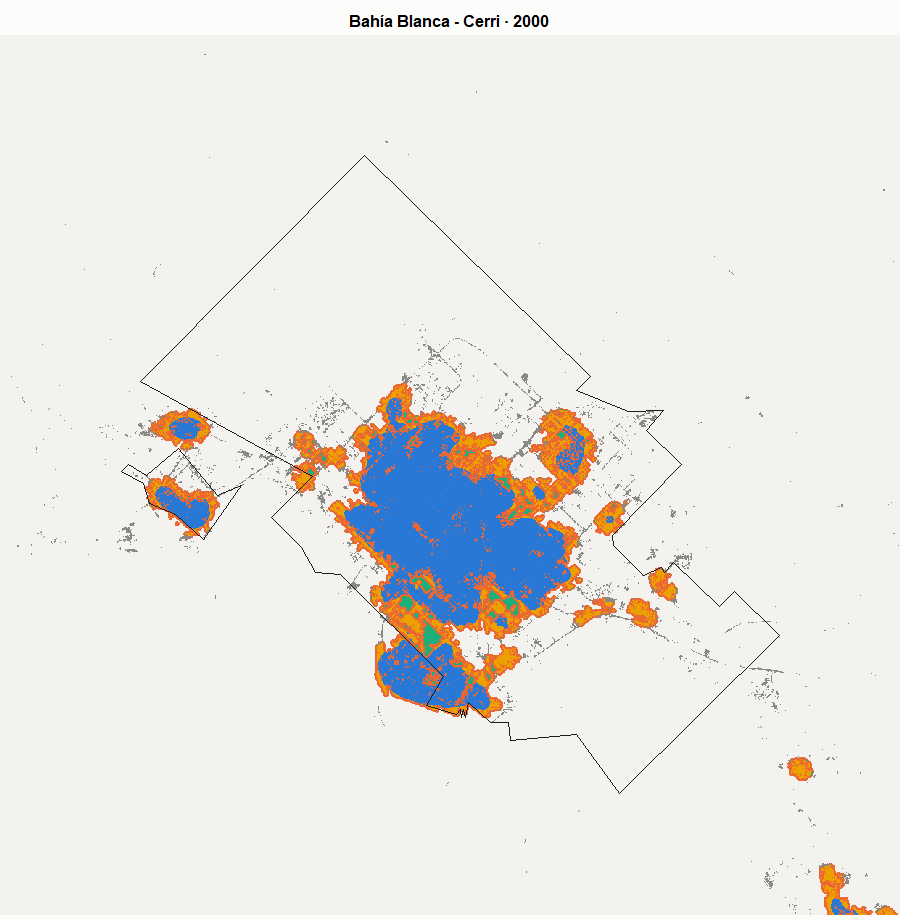</a></td></tr>
<tr><td><a href="img/maps/bahia_blanca_2010.png">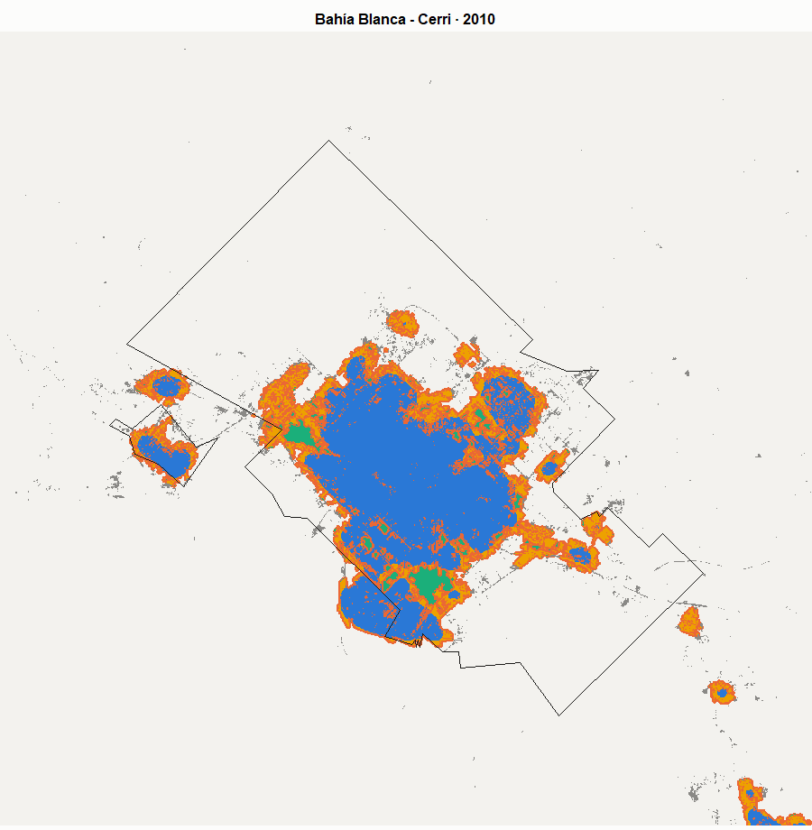</a></td><td><a href="img/maps/bahia_blanca_2020.png">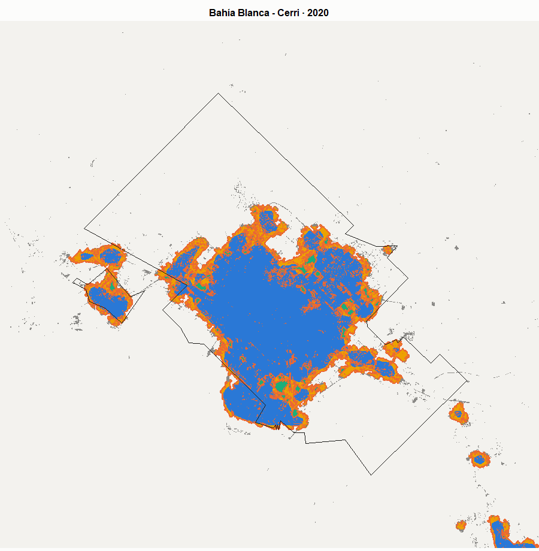</a></td></tr>
</table>

Maps are framed on the perimeter plus 5 km; the metrics use the larger box of `cajas.md` (slug `bahia_blanca`).

[Back to contents](#contents)

### Comodoro Rivadavia - Rada Tilly

Province: Chubut.

Built-up land in the city's urban extent grew from **24.1 km²** in 1990 to **56.2 km²** in 2020, **2.86 % a year** (pace: **fast**). The urban extent went from 40.9 to 86.0 km². Saturation moved from 0.59 to 0.65 (shape: **filling in**).

The fringe open space was 39.9 % of the urban extent in 1990 and 33.9 % in 2020; in 2020 it adds 51 % to the rest of the extent. Counting it changes the 1990-2020 growth rate from 2.83 % to 2.50 % a year (-0.33 points).

- The perimeter has 5 parts; patches touching any of them count as the city.

#### Growth by class

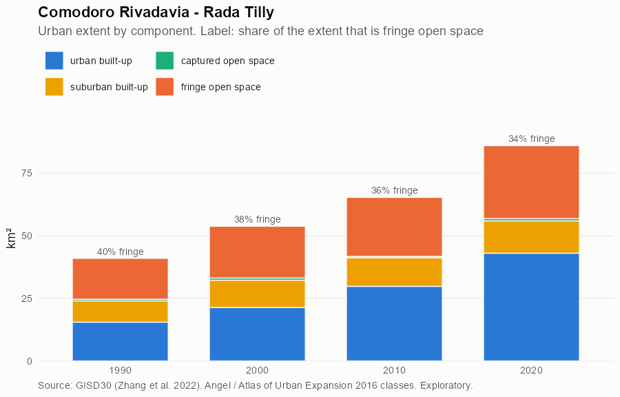

|  | urban | suburban | captured | fringe | extent | % fringe | built-up | saturation | openness | project footprint |
|---|---|---|---|---|---|---|---|---|---|---|
| 1990 | 15.5 | 8.5 | 0.6 | 16.3 | 40.9 | 39.9 | 24.1 | 0.59 | 0.37 | 55.7 |
| 2000 | 21.3 | 10.9 | 0.9 | 20.7 | 53.8 | 38.5 | 32.4 | 0.60 | 0.36 | 70.3 |
| 2010 | 29.8 | 11.4 | 0.5 | 23.6 | 65.3 | 36.1 | 41.4 | 0.63 | 0.34 | 80.7 |
| 2020 | 43.0 | 12.9 | 0.9 | 29.2 | 86.0 | 33.9 | 56.2 | 0.65 | 0.31 | 101.0 |

km². Rural built-up and rural open space lie outside the urban extent; they appear on the maps.

#### Growth by decade

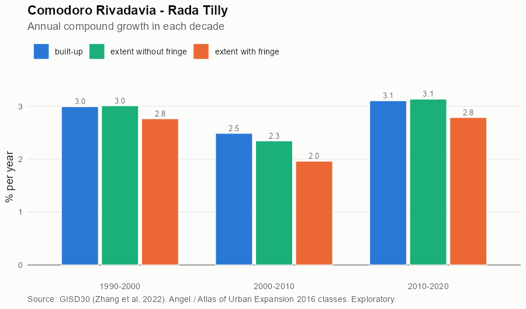

| Decade | built-up | extent without fringe | extent with fringe |
|---|---|---|---|
| 1990-2000 | 2.99 | 3.01 | 2.76 |
| 2000-2010 | 2.49 | 2.35 | 1.96 |
| 2010-2020 | 3.10 | 3.13 | 2.79 |

% per year.

#### Maps

<table>
<tr><td><a href="img/maps/comodoro_rivadavia_1990.png">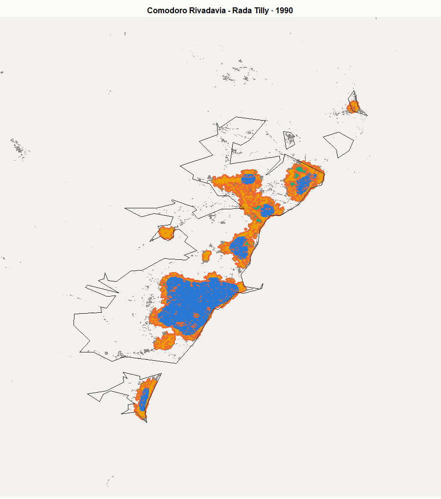</a></td><td><a href="img/maps/comodoro_rivadavia_2000.png">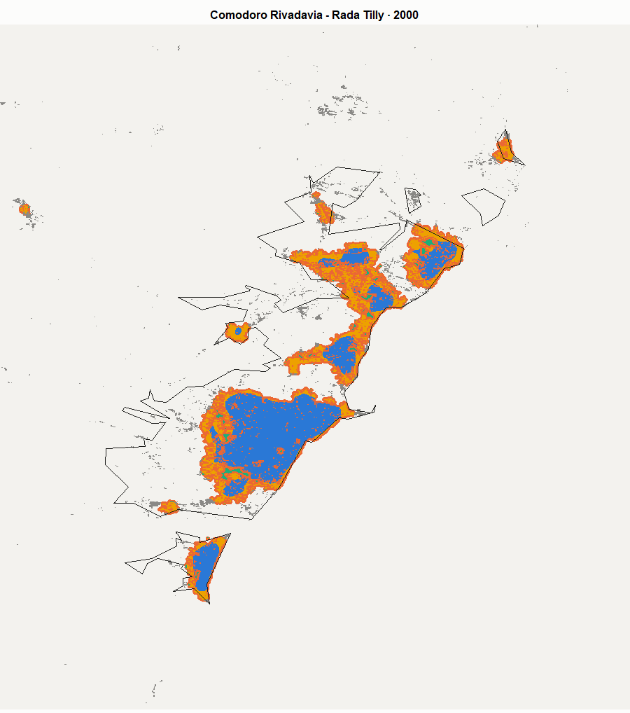</a></td></tr>
<tr><td><a href="img/maps/comodoro_rivadavia_2010.png">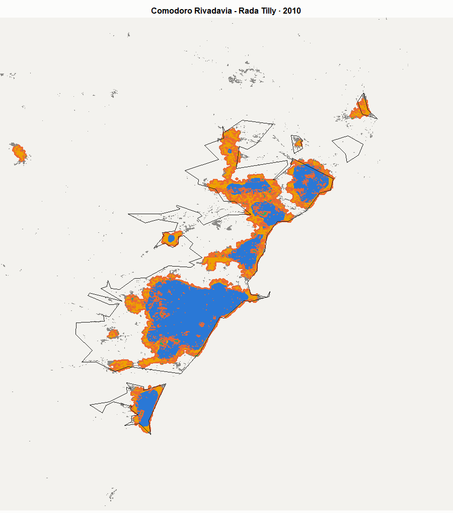</a></td><td><a href="img/maps/comodoro_rivadavia_2020.png">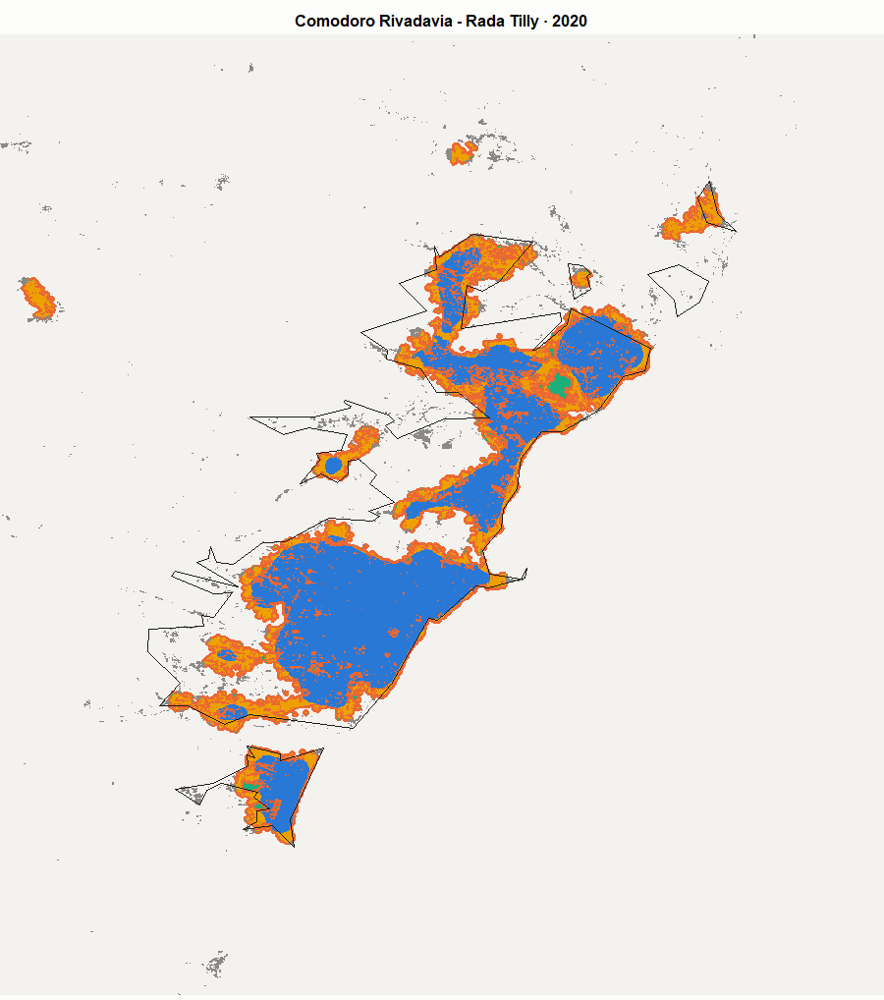</a></td></tr>
</table>

Maps are framed on the perimeter plus 5 km; the metrics use the larger box of `cajas.md` (slug `comodoro_rivadavia`).

[Back to contents](#contents)

### Concordia

Province: Entre Ríos.

Built-up land in the city's urban extent grew from **14.9 km²** in 1990 to **31.2 km²** in 2020, **2.48 % a year** (pace: **moderate**). The urban extent went from 22.0 to 44.1 km². Saturation moved from 0.68 to 0.71 (shape: **stable**).

The fringe open space was 31.4 % of the urban extent in 1990 and 28.8 % in 2020; in 2020 it adds 41 % to the rest of the extent. Counting it changes the 1990-2020 growth rate from 2.48 % to 2.35 % a year (-0.13 points).

- The perimeter has 2 parts; patches touching any of them count as the city.

#### Growth by class

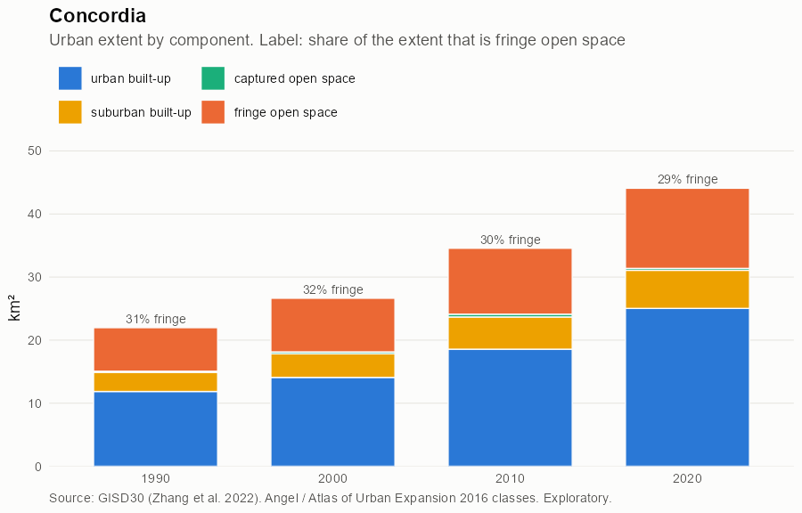

|  | urban | suburban | captured | fringe | extent | % fringe | built-up | saturation | openness | project footprint |
|---|---|---|---|---|---|---|---|---|---|---|
| 1990 | 11.9 | 3.0 | 0.2 | 6.9 | 22.0 | 31.4 | 14.9 | 0.68 | 0.26 | 29.4 |
| 2000 | 14.1 | 3.8 | 0.3 | 8.5 | 26.6 | 31.9 | 17.9 | 0.67 | 0.26 | 34.1 |
| 2010 | 18.6 | 5.1 | 0.4 | 10.5 | 34.6 | 30.2 | 23.8 | 0.69 | 0.26 | 43.9 |
| 2020 | 25.0 | 6.0 | 0.3 | 12.7 | 44.1 | 28.8 | 31.2 | 0.71 | 0.25 | 56.6 |

km². Rural built-up and rural open space lie outside the urban extent; they appear on the maps.

#### Growth by decade

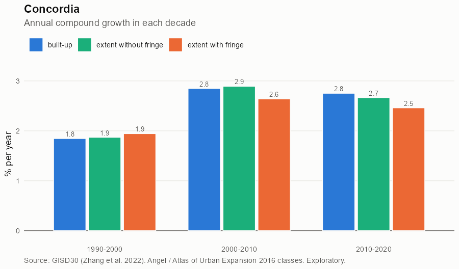

| Decade | built-up | extent without fringe | extent with fringe |
|---|---|---|---|
| 1990-2000 | 1.85 | 1.87 | 1.94 |
| 2000-2010 | 2.85 | 2.89 | 2.64 |
| 2010-2020 | 2.75 | 2.67 | 2.46 |

% per year.

#### Maps

<table>
<tr><td><a href="img/maps/concordia_1990.png">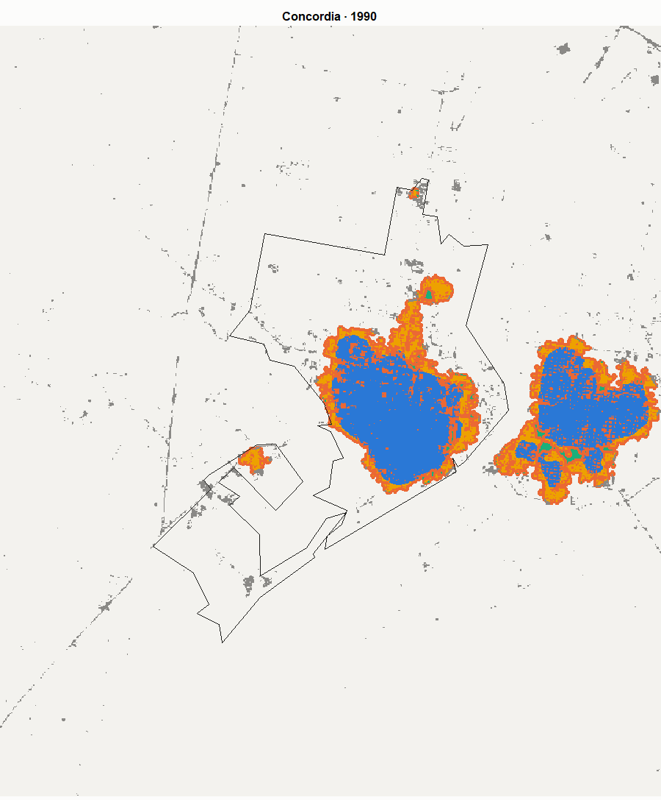</a></td><td><a href="img/maps/concordia_2000.png">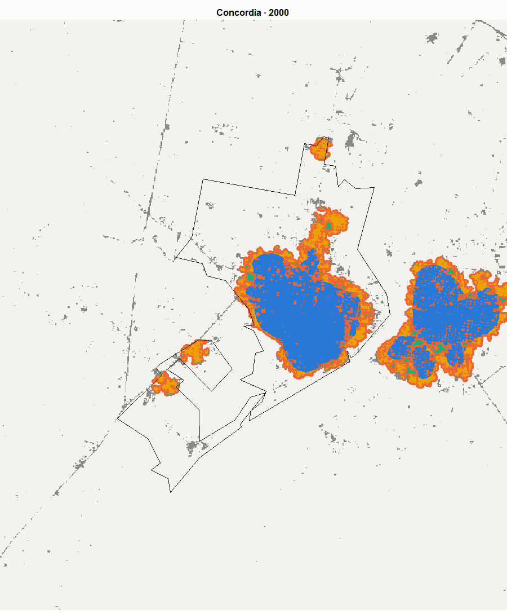</a></td></tr>
<tr><td><a href="img/maps/concordia_2010.png">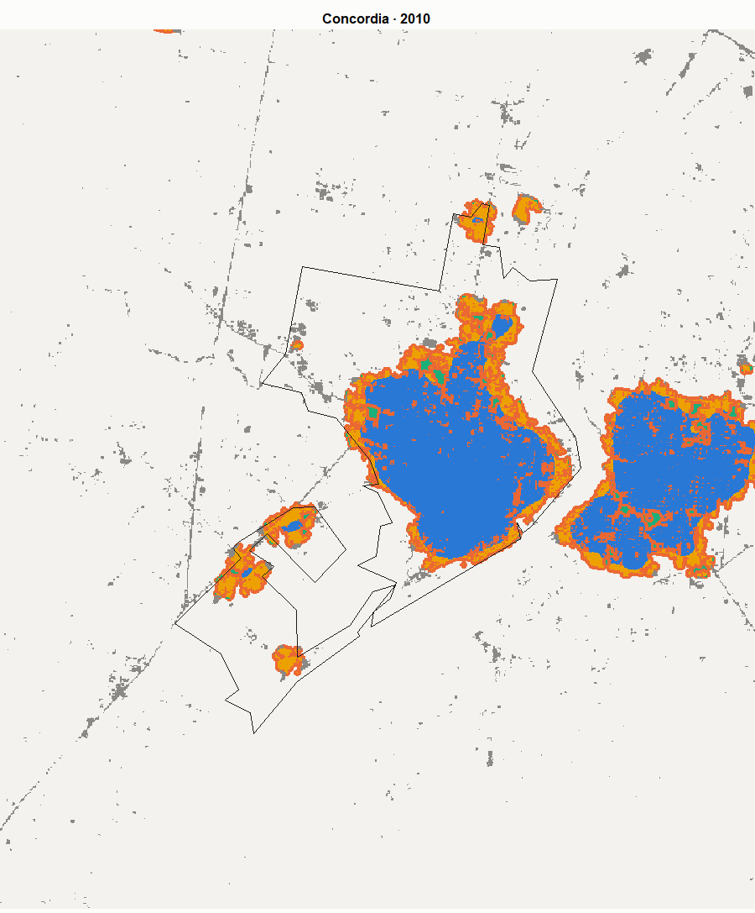</a></td><td><a href="img/maps/concordia_2020.png">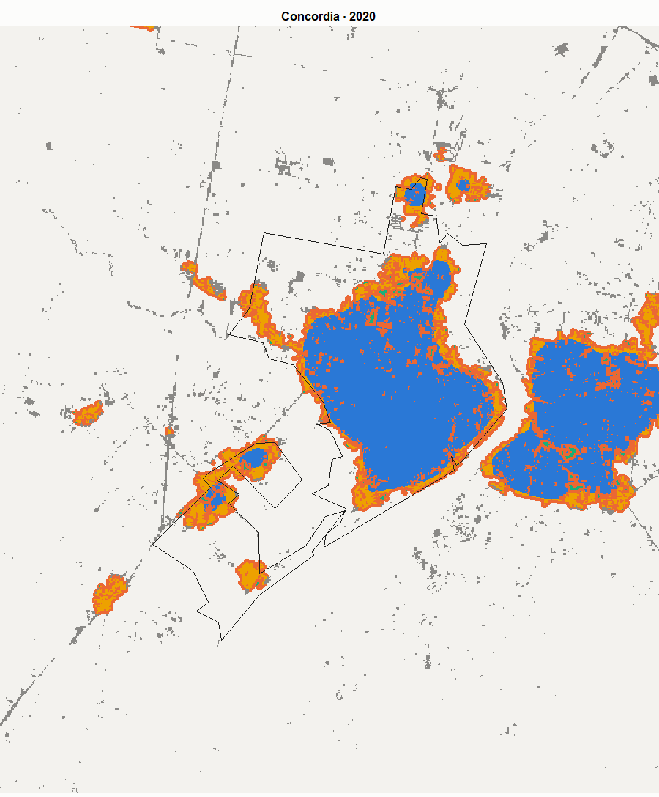</a></td></tr>
</table>

Maps are framed on the perimeter plus 5 km; the metrics use the larger box of `cajas.md` (slug `concordia`).

[Back to contents](#contents)

### Corrientes

Province: Corrientes.

Built-up land in the city's urban extent grew from **31.0 km²** in 1990 to **56.9 km²** in 2020, **2.04 % a year** (pace: **moderate**). The urban extent went from 43.2 to 79.4 km². Saturation moved from 0.72 to 0.72 (shape: **stable**).

The fringe open space was 27.2 % of the urban extent in 1990 and 24.9 % in 2020; in 2020 it adds 33 % to the rest of the extent. Counting it changes the 1990-2020 growth rate from 2.16 % to 2.05 % a year (-0.10 points).

- The perimeter has 2 parts; patches touching any of them count as the city.

#### Growth by class

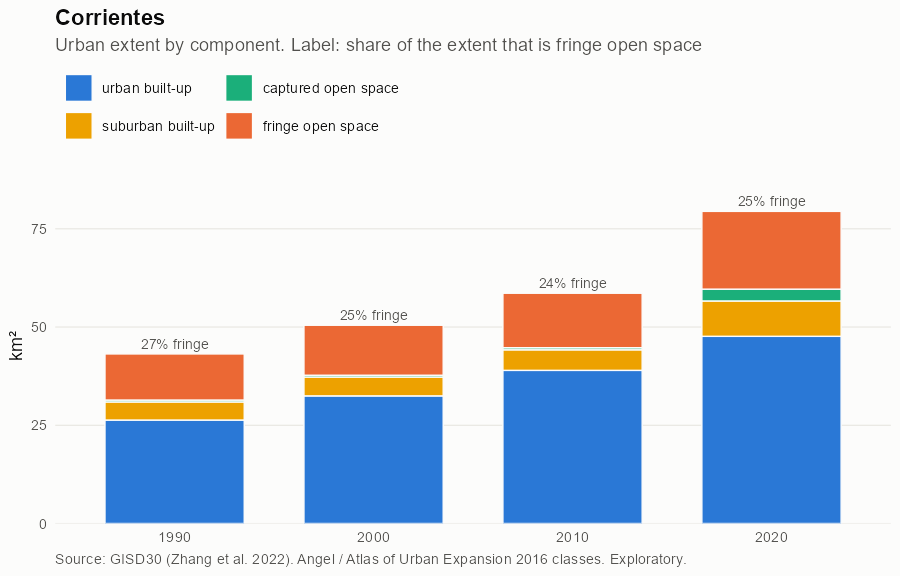

|  | urban | suburban | captured | fringe | extent | % fringe | built-up | saturation | openness | project footprint |
|---|---|---|---|---|---|---|---|---|---|---|
| 1990 | 26.3 | 4.6 | 0.5 | 11.7 | 43.2 | 27.2 | 31.0 | 0.72 | 0.24 | 53.1 |
| 2000 | 32.5 | 4.8 | 0.4 | 12.7 | 50.5 | 25.2 | 37.3 | 0.74 | 0.22 | 61.6 |
| 2010 | 39.0 | 5.2 | 0.5 | 13.9 | 58.6 | 23.7 | 44.2 | 0.76 | 0.20 | 72.3 |
| 2020 | 47.6 | 9.0 | 3.0 | 19.8 | 79.4 | 24.9 | 56.9 | 0.72 | 0.21 | 96.1 |

km². Rural built-up and rural open space lie outside the urban extent; they appear on the maps.

#### Growth by decade

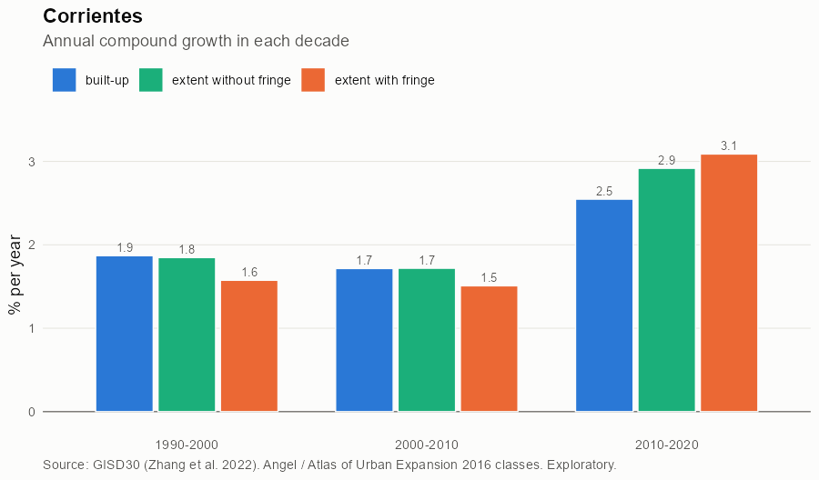

| Decade | built-up | extent without fringe | extent with fringe |
|---|---|---|---|
| 1990-2000 | 1.87 | 1.85 | 1.57 |
| 2000-2010 | 1.72 | 1.72 | 1.51 |
| 2010-2020 | 2.55 | 2.92 | 3.09 |

% per year.

#### Maps

<table>
<tr><td><a href="img/maps/corrientes_1990.png">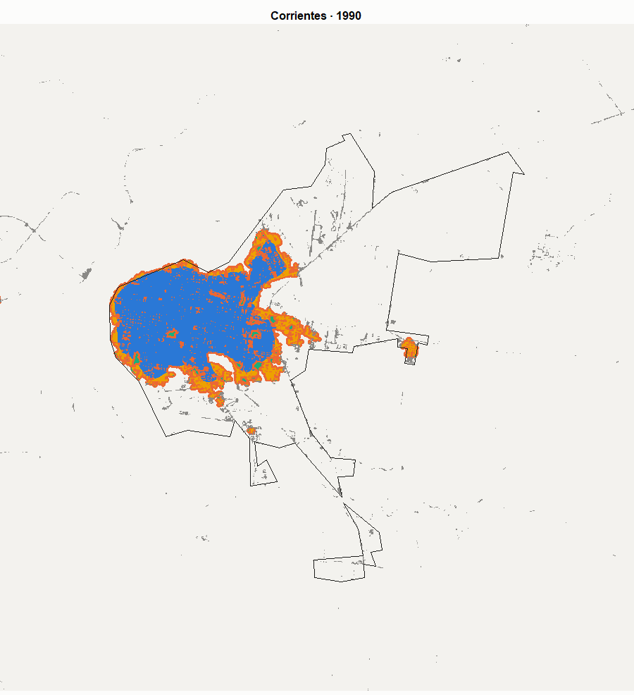</a></td><td><a href="img/maps/corrientes_2000.png">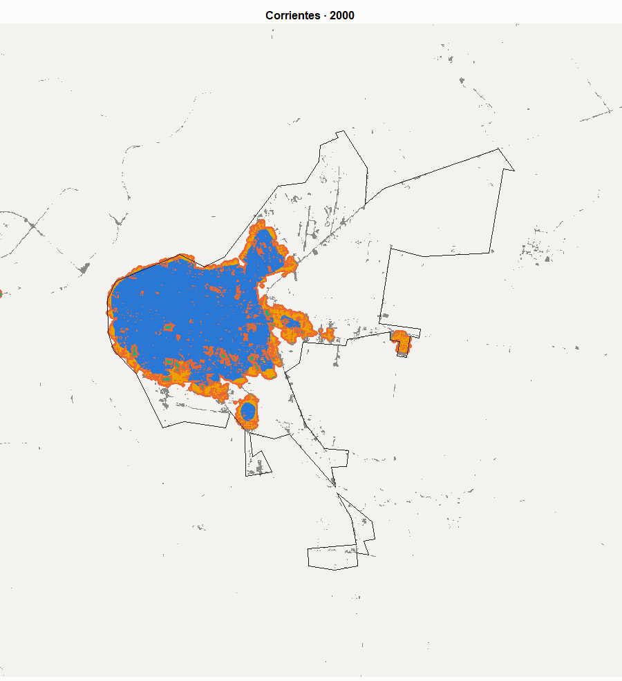</a></td></tr>
<tr><td><a href="img/maps/corrientes_2010.png">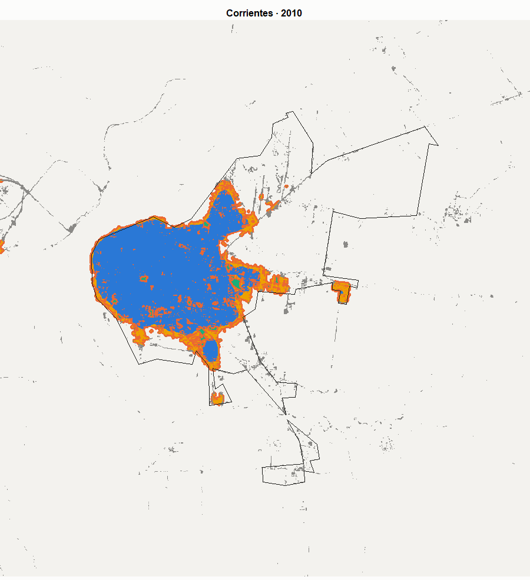</a></td><td><a href="img/maps/corrientes_2020.png">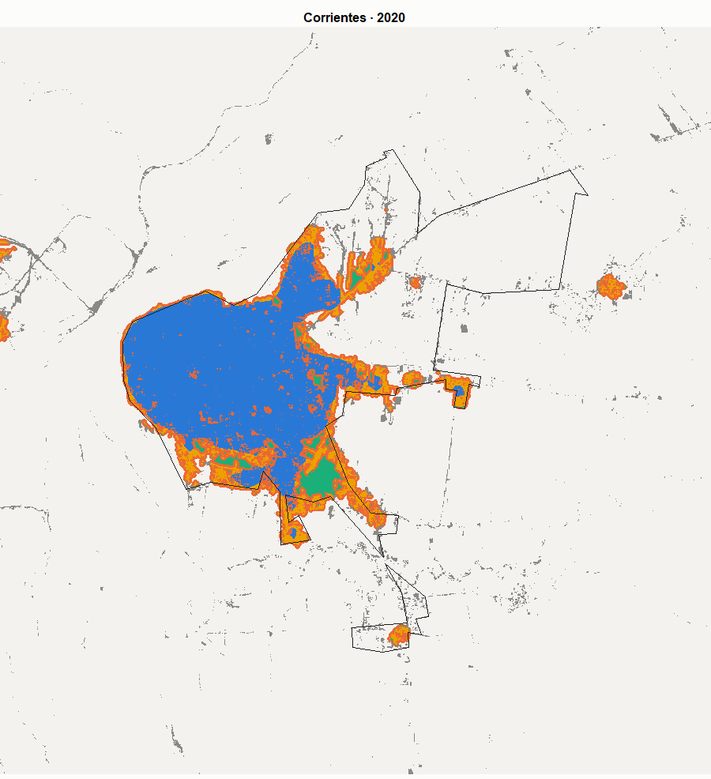</a></td></tr>
</table>

Maps are framed on the perimeter plus 5 km; the metrics use the larger box of `cajas.md` (slug `corrientes`).

[Back to contents](#contents)

### Formosa

Province: Formosa.

Built-up land in the city's urban extent grew from **22.1 km²** in 1990 to **51.6 km²** in 2020, **2.86 % a year** (pace: **fast**). The urban extent went from 32.5 to 74.6 km². Saturation moved from 0.68 to 0.69 (shape: **stable**).

The fringe open space was 29.9 % of the urban extent in 1990 and 29.6 % in 2020; in 2020 it adds 42 % to the rest of the extent. Counting it changes the 1990-2020 growth rate from 2.83 % to 2.81 % a year (-0.02 points).

#### Growth by class

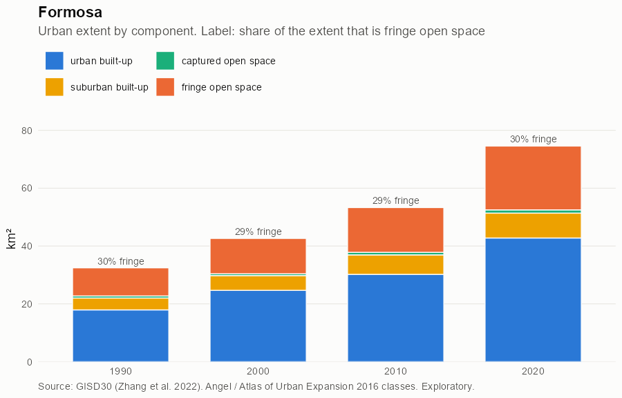

|  | urban | suburban | captured | fringe | extent | % fringe | built-up | saturation | openness | project footprint |
|---|---|---|---|---|---|---|---|---|---|---|
| 1990 | 17.9 | 4.1 | 0.7 | 9.7 | 32.5 | 29.9 | 22.1 | 0.68 | 0.29 | 41.1 |
| 2000 | 24.7 | 5.1 | 0.6 | 12.2 | 42.6 | 28.7 | 29.9 | 0.70 | 0.26 | 53.4 |
| 2010 | 30.2 | 6.7 | 0.9 | 15.5 | 53.3 | 29.0 | 37.0 | 0.69 | 0.25 | 69.8 |
| 2020 | 42.8 | 8.6 | 1.1 | 22.1 | 74.6 | 29.6 | 51.6 | 0.69 | 0.25 | 90.4 |

km². Rural built-up and rural open space lie outside the urban extent; they appear on the maps.

#### Growth by decade

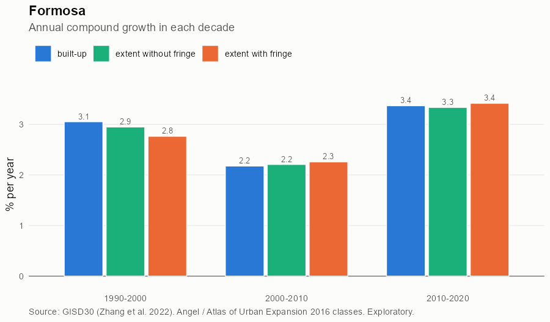

| Decade | built-up | extent without fringe | extent with fringe |
|---|---|---|---|
| 1990-2000 | 3.05 | 2.95 | 2.76 |
| 2000-2010 | 2.18 | 2.21 | 2.26 |
| 2010-2020 | 3.37 | 3.33 | 3.42 |

% per year.

#### Maps

<table>
<tr><td><a href="img/maps/formosa_1990.png">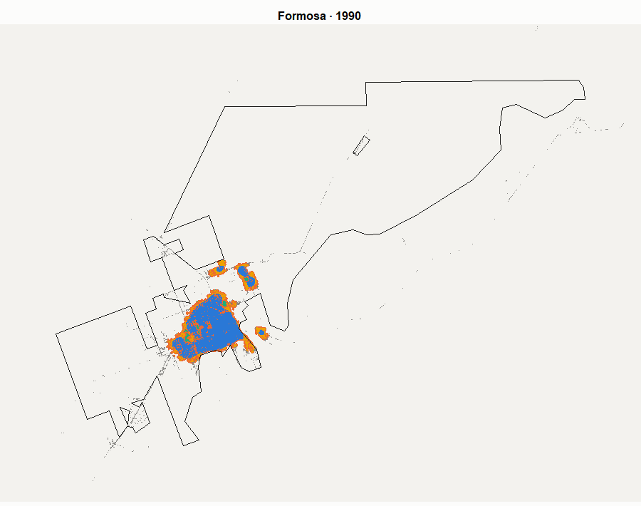</a></td><td><a href="img/maps/formosa_2000.png">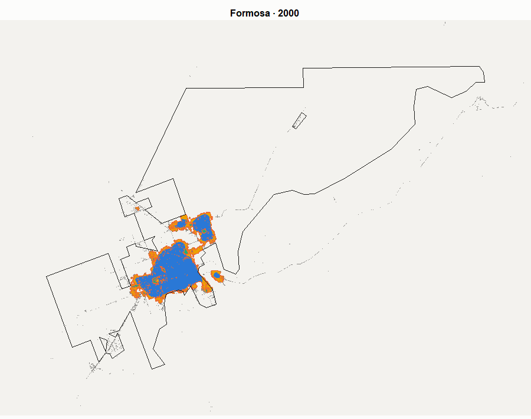</a></td></tr>
<tr><td><a href="img/maps/formosa_2010.png">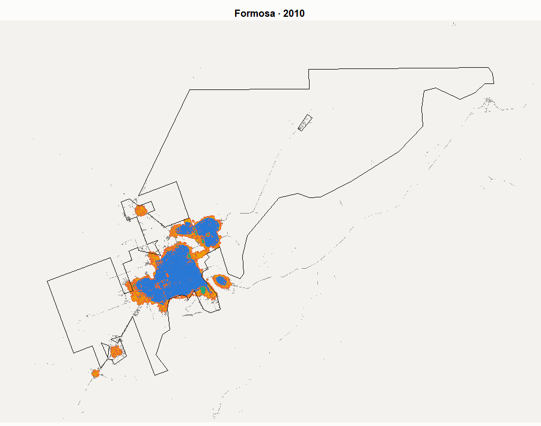</a></td><td><a href="img/maps/formosa_2020.png">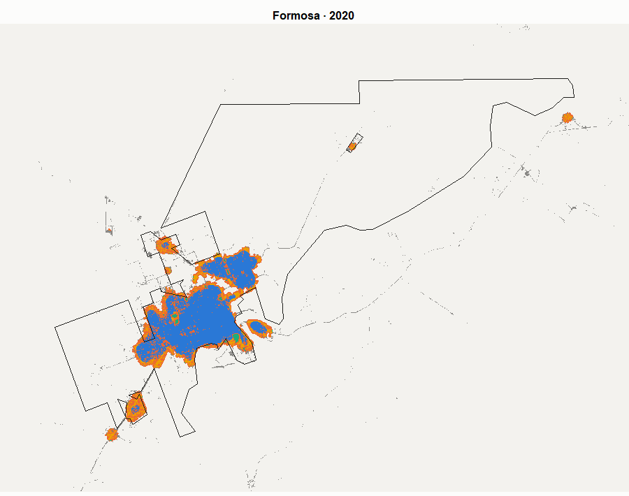</a></td></tr>
</table>

Maps are framed on the perimeter plus 5 km; the metrics use the larger box of `cajas.md` (slug `formosa`).

[Back to contents](#contents)

### Gran Buenos Aires

Province: Buenos Aires, Ciudad de Buenos Aires.

Built-up land in the city's urban extent grew from **1,281.3 km²** in 1990 to **1,945.1 km²** in 2020, **1.40 % a year** (pace: **slow**). The urban extent went from 1,704.1 to 2,547.0 km². Saturation moved from 0.75 to 0.76 (shape: **stable**).

The fringe open space was 22.6 % of the urban extent in 1990 and 21.8 % in 2020; in 2020 it adds 28 % to the rest of the extent. Counting it changes the 1990-2020 growth rate from 1.38 % to 1.35 % a year (-0.04 points).

- The perimeter has 44 parts; patches touching any of them count as the city.

#### Growth by class

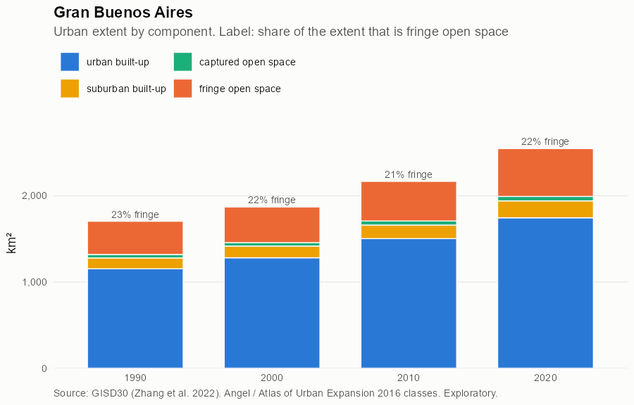

|  | urban | suburban | captured | fringe | extent | % fringe | built-up | saturation | openness | project footprint |
|---|---|---|---|---|---|---|---|---|---|---|
| 1990 | 1,152.5 | 126.1 | 40.1 | 385.4 | 1,704.1 | 22.6 | 1,281.3 | 0.75 | 0.19 | 1,898.6 |
| 2000 | 1,280.4 | 136.1 | 39.3 | 413.5 | 1,869.3 | 22.1 | 1,419.2 | 0.76 | 0.18 | 2,079.4 |
| 2010 | 1,502.8 | 157.3 | 47.1 | 459.5 | 2,166.7 | 21.2 | 1,663.7 | 0.77 | 0.17 | 2,409.8 |
| 2020 | 1,744.5 | 196.4 | 51.3 | 554.9 | 2,547.0 | 21.8 | 1,945.1 | 0.76 | 0.17 | 2,826.7 |

km². Rural built-up and rural open space lie outside the urban extent; they appear on the maps.

#### Growth by decade

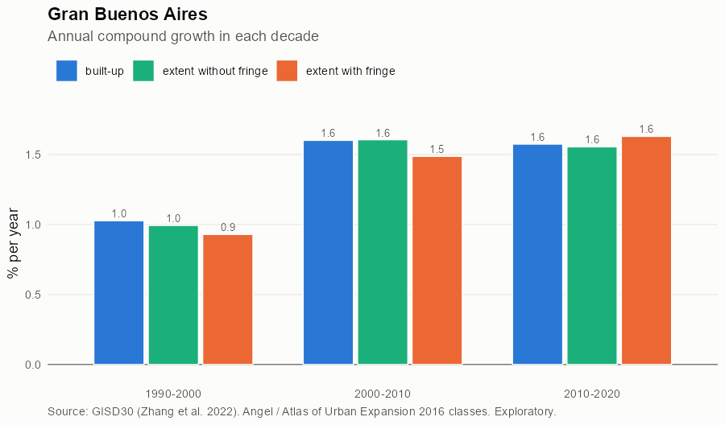

| Decade | built-up | extent without fringe | extent with fringe |
|---|---|---|---|
| 1990-2000 | 1.03 | 0.99 | 0.93 |
| 2000-2010 | 1.60 | 1.61 | 1.49 |
| 2010-2020 | 1.58 | 1.56 | 1.63 |

% per year.

#### Maps

<table>
<tr><td><a href="img/maps/buenos_aires_1990.png">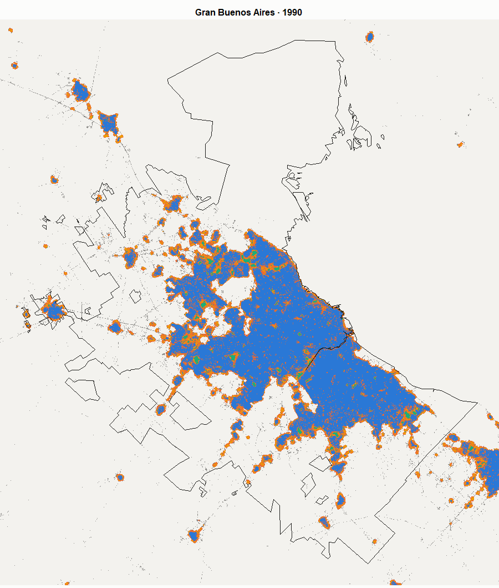</a></td><td><a href="img/maps/buenos_aires_2000.png">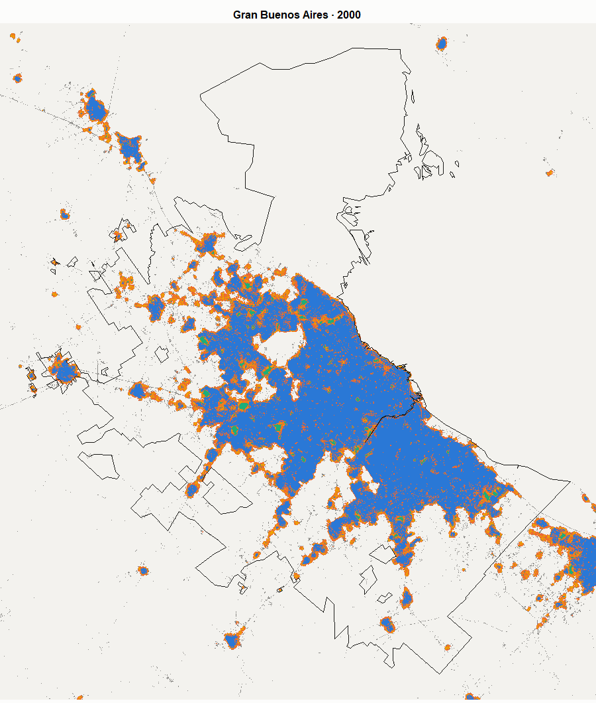</a></td></tr>
<tr><td><a href="img/maps/buenos_aires_2010.png">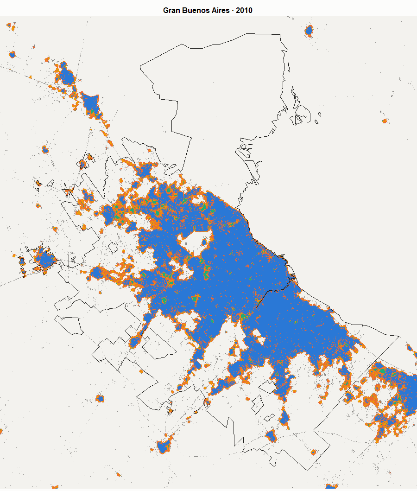</a></td><td><a href="img/maps/buenos_aires_2020.png">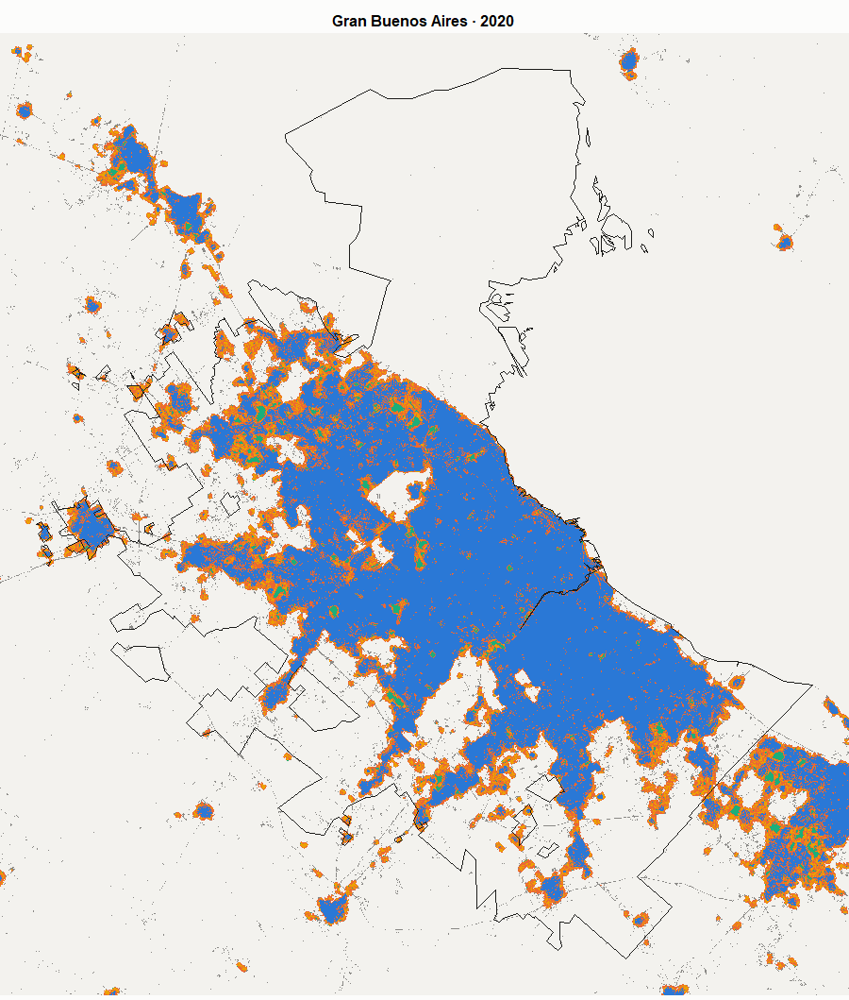</a></td></tr>
</table>

Maps are framed on the perimeter plus 5 km; the metrics use the larger box of `cajas.md` (slug `buenos_aires`).

[Back to contents](#contents)

### Gran Catamarca

Province: Catamarca.

Built-up land in the city's urban extent grew from **16.0 km²** in 1990 to **52.1 km²** in 2020, **4.01 % a year** (pace: **very fast**). The urban extent went from 26.9 to 76.8 km². Saturation moved from 0.60 to 0.68 (shape: **filling in**).

The fringe open space was 39.7 % of the urban extent in 1990 and 30.7 % in 2020; in 2020 it adds 44 % to the rest of the extent. Counting it changes the 1990-2020 growth rate from 4.04 % to 3.56 % a year (-0.48 points).

- **Check:** built-up grows 4.01 % a year, at or above the 4 % flag. In arid areas GISD30 reads bare soil as impervious; confirm against GHSL or imagery before using these numbers.

#### Growth by class

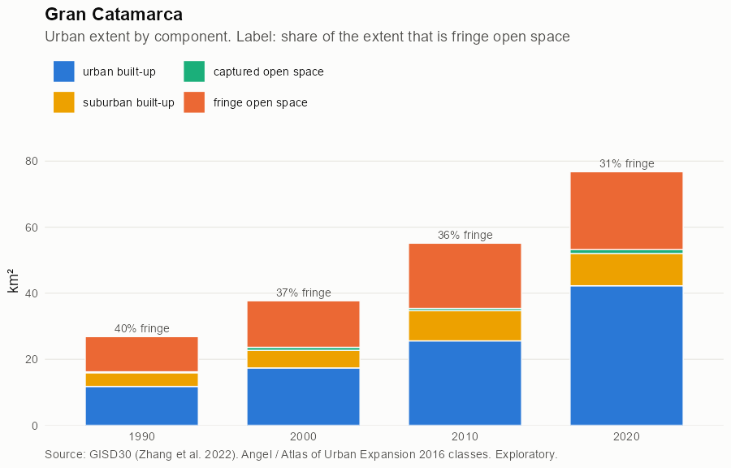

|  | urban | suburban | captured | fringe | extent | % fringe | built-up | saturation | openness | project footprint |
|---|---|---|---|---|---|---|---|---|---|---|
| 1990 | 11.8 | 4.1 | 0.3 | 10.7 | 26.9 | 39.7 | 16.0 | 0.60 | 0.33 | 41.0 |
| 2000 | 17.4 | 5.3 | 0.9 | 14.1 | 37.7 | 37.4 | 22.9 | 0.61 | 0.31 | 51.2 |
| 2010 | 25.6 | 9.1 | 0.7 | 19.7 | 55.1 | 35.8 | 34.9 | 0.63 | 0.30 | 69.5 |
| 2020 | 42.3 | 9.8 | 1.2 | 23.6 | 76.8 | 30.7 | 52.1 | 0.68 | 0.25 | 92.5 |

km². Rural built-up and rural open space lie outside the urban extent; they appear on the maps.

#### Growth by decade

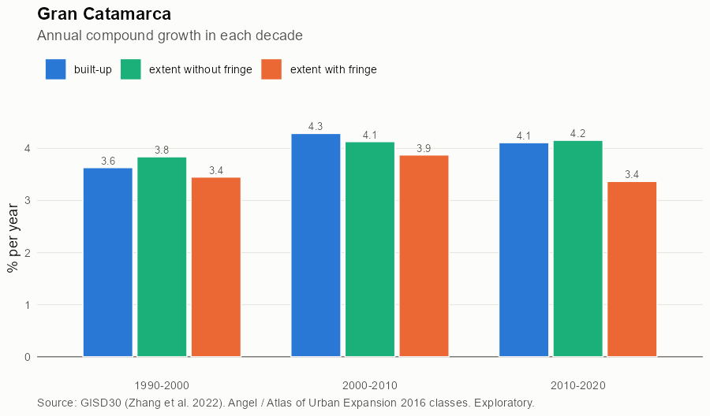

| Decade | built-up | extent without fringe | extent with fringe |
|---|---|---|---|
| 1990-2000 | 3.63 | 3.84 | 3.45 |
| 2000-2010 | 4.29 | 4.13 | 3.87 |
| 2010-2020 | 4.11 | 4.16 | 3.37 |

% per year.

#### Maps

<table>
<tr><td><a href="img/maps/catamarca_1990.png">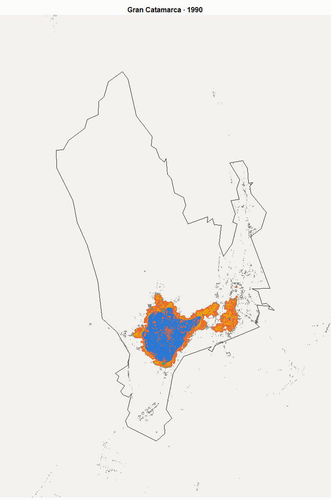</a></td><td><a href="img/maps/catamarca_2000.png">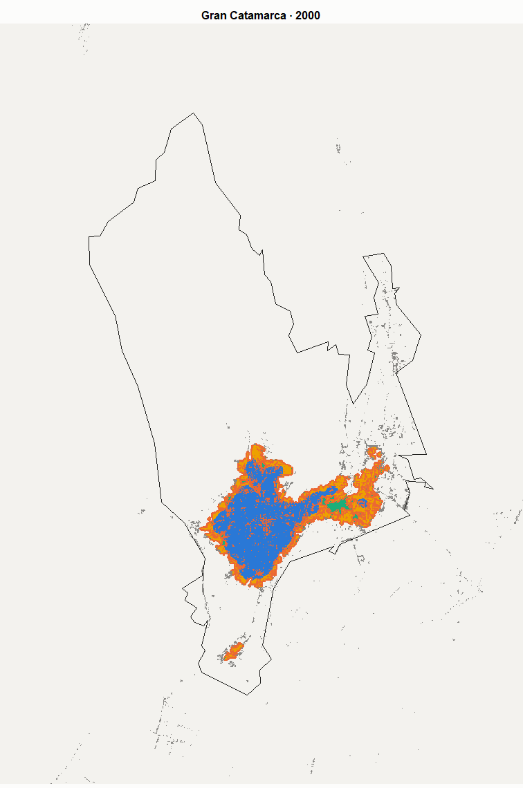</a></td></tr>
<tr><td><a href="img/maps/catamarca_2010.png">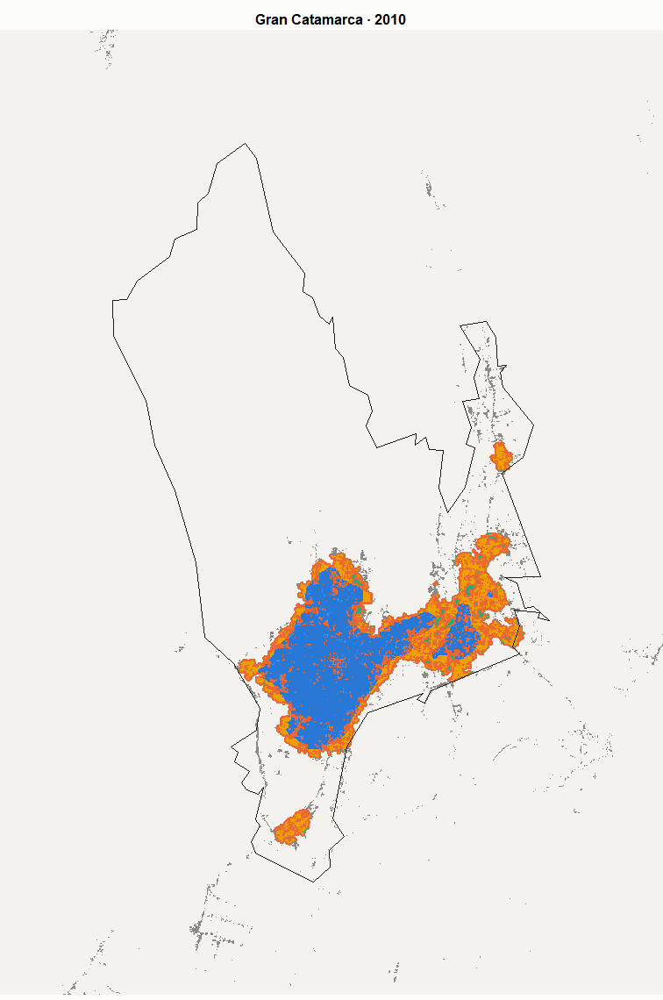</a></td><td><a href="img/maps/catamarca_2020.png">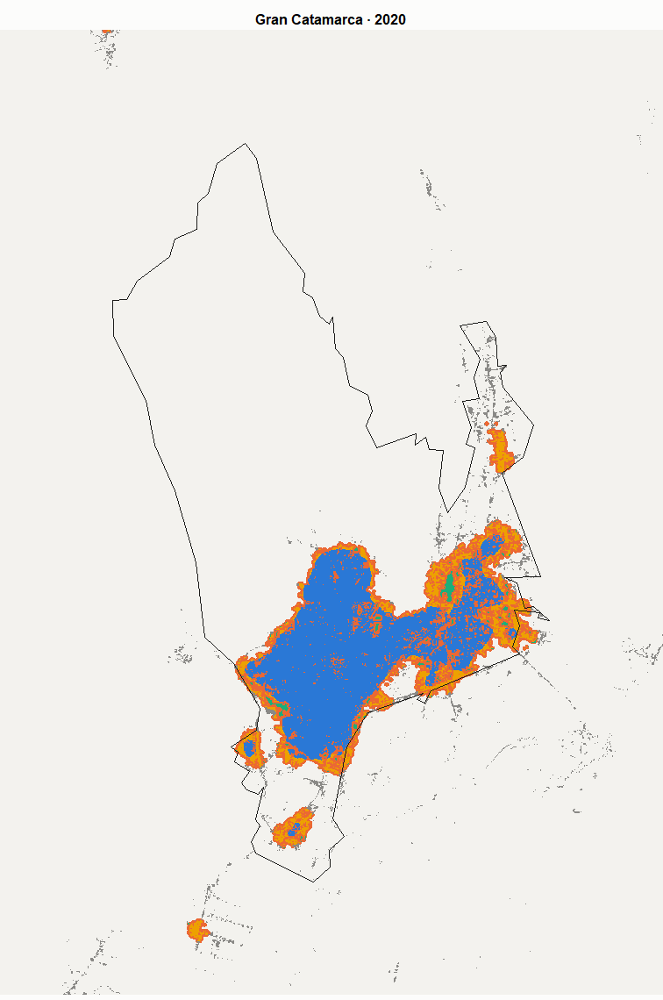</a></td></tr>
</table>

Maps are framed on the perimeter plus 5 km; the metrics use the larger box of `cajas.md` (slug `catamarca`).

[Back to contents](#contents)

### Gran Córdoba

Province: Córdoba.

Built-up land in the city's urban extent grew from **146.3 km²** in 1990 to **302.8 km²** in 2020, **2.45 % a year** (pace: **moderate**). The urban extent went from 208.9 to 426.4 km². Saturation moved from 0.70 to 0.71 (shape: **stable**).

The fringe open space was 27.7 % of the urban extent in 1990 and 27.0 % in 2020; in 2020 it adds 37 % to the rest of the extent. Counting it changes the 1990-2020 growth rate from 2.44 % to 2.41 % a year (-0.03 points).

- The perimeter has 7 parts; patches touching any of them count as the city.

#### Growth by class

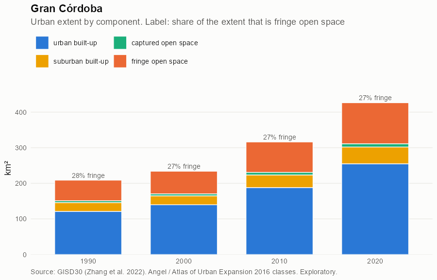

|  | urban | suburban | captured | fringe | extent | % fringe | built-up | saturation | openness | project footprint |
|---|---|---|---|---|---|---|---|---|---|---|
| 1990 | 121.1 | 24.8 | 5.1 | 57.9 | 208.9 | 27.7 | 146.3 | 0.70 | 0.24 | 245.7 |
| 2000 | 139.6 | 25.2 | 5.5 | 63.6 | 233.9 | 27.2 | 165.4 | 0.71 | 0.23 | 275.2 |
| 2010 | 188.0 | 35.5 | 7.3 | 85.4 | 316.2 | 27.0 | 224.3 | 0.71 | 0.22 | 380.0 |
| 2020 | 254.9 | 47.2 | 9.2 | 115.2 | 426.4 | 27.0 | 302.8 | 0.71 | 0.22 | 496.4 |

km². Rural built-up and rural open space lie outside the urban extent; they appear on the maps.

#### Growth by decade

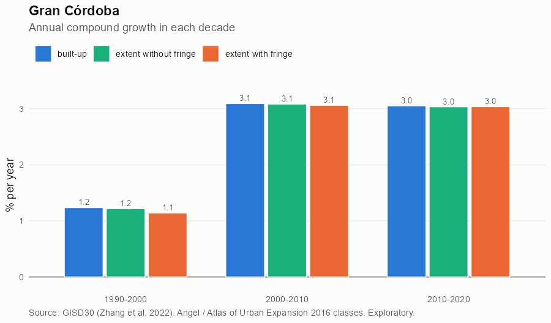

| Decade | built-up | extent without fringe | extent with fringe |
|---|---|---|---|
| 1990-2000 | 1.24 | 1.22 | 1.14 |
| 2000-2010 | 3.09 | 3.08 | 3.06 |
| 2010-2020 | 3.05 | 3.03 | 3.03 |

% per year.

#### Maps

<table>
<tr><td><a href="img/maps/cordoba_1990.png">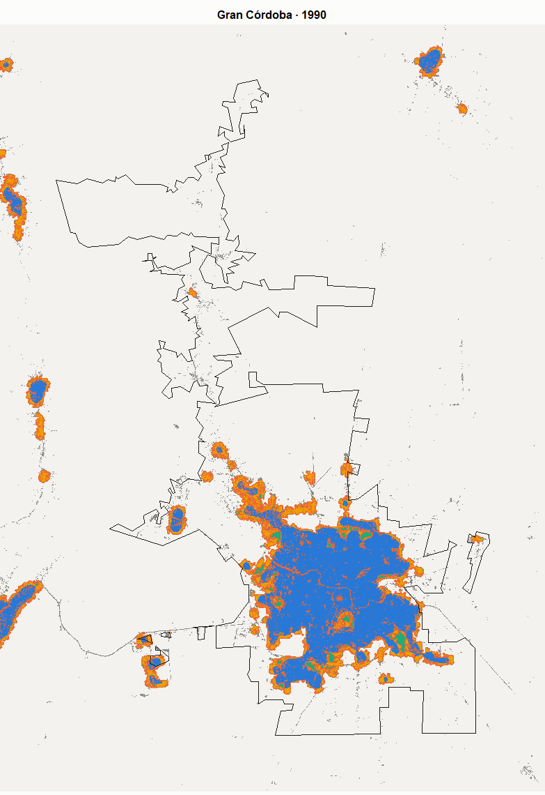</a></td><td></td></tr>
<tr><td></td><td></td></tr>
</table>

Maps are framed on the perimeter plus 5 km; the metrics use the larger box of `cajas.md` (slug `cordoba`).

[Back to contents](#contents)

### Gran La Plata

Province: Buenos Aires.

Built-up land in the city's urban extent grew from **115.3 km²** in 1990 to **246.4 km²** in 2020, **2.56 % a year** (pace: **fast**). The urban extent went from 170.0 to 384.5 km². Saturation moved from 0.68 to 0.64 (shape: **spreading out**).

The fringe open space was 30.3 % of the urban extent in 1990 and 32.7 % in 2020; in 2020 it adds 49 % to the rest of the extent. Counting it changes the 1990-2020 growth rate from 2.64 % to 2.76 % a year (+0.12 points).

#### Growth by class

|  | urban | suburban | captured | fringe | extent | % fringe | built-up | saturation | openness | project footprint |
|---|---|---|---|---|---|---|---|---|---|---|
| 1990 | 92.7 | 22.2 | 3.6 | 51.6 | 170.0 | 30.3 | 115.3 | 0.68 | 0.26 | 213.1 |
| 2000 | 101.4 | 26.9 | 4.3 | 62.4 | 195.0 | 32.0 | 128.7 | 0.66 | 0.27 | 259.2 |
| 2010 | 137.1 | 44.0 | 8.9 | 95.9 | 286.0 | 33.5 | 182.1 | 0.64 | 0.30 | 345.0 |
| 2020 | 193.5 | 51.5 | 13.9 | 125.6 | 384.5 | 32.7 | 246.4 | 0.64 | 0.29 | 462.7 |

km². Rural built-up and rural open space lie outside the urban extent; they appear on the maps.

#### Growth by decade

| Decade | built-up | extent without fringe | extent with fringe |
|---|---|---|---|
| 1990-2000 | 1.10 | 1.13 | 1.38 |
| 2000-2010 | 3.53 | 3.67 | 3.91 |
| 2010-2020 | 3.07 | 3.14 | 3.00 |

% per year.

#### Maps

<table>
<tr><td></td><td></td></tr>
<tr><td></td><td></td></tr>
</table>

Maps are framed on the perimeter plus 5 km; the metrics use the larger box of `cajas.md` (slug `la_plata`).

[Back to contents](#contents)

### Gran Mendoza

Province: Mendoza.

Built-up land in the city's urban extent grew from **76.6 km²** in 1990 to **201.4 km²** in 2020, **3.28 % a year** (pace: **fast**). The urban extent went from 140.1 to 328.6 km². Saturation moved from 0.55 to 0.61 (shape: **filling in**).

The fringe open space was 42.9 % of the urban extent in 1990 and 36.3 % in 2020; in 2020 it adds 57 % to the rest of the extent. Counting it changes the 1990-2020 growth rate from 3.26 % to 2.88 % a year (-0.38 points).

- The perimeter has 4 parts; patches touching any of them count as the city.

#### Growth by class

|  | urban | suburban | captured | fringe | extent | % fringe | built-up | saturation | openness | project footprint |
|---|---|---|---|---|---|---|---|---|---|---|
| 1990 | 51.7 | 24.2 | 4.1 | 60.0 | 140.1 | 42.9 | 76.6 | 0.55 | 0.41 | 216.9 |
| 2000 | 69.6 | 28.5 | 6.2 | 71.9 | 176.2 | 40.8 | 99.0 | 0.56 | 0.38 | 266.0 |
| 2010 | 98.6 | 35.6 | 4.0 | 87.7 | 226.0 | 38.8 | 134.8 | 0.60 | 0.34 | 329.2 |
| 2020 | 151.2 | 49.1 | 9.2 | 119.1 | 328.6 | 36.3 | 201.4 | 0.61 | 0.31 | 454.5 |

km². Rural built-up and rural open space lie outside the urban extent; they appear on the maps.

#### Growth by decade

| Decade | built-up | extent without fringe | extent with fringe |
|---|---|---|---|
| 1990-2000 | 2.60 | 2.69 | 2.32 |
| 2000-2010 | 3.14 | 2.85 | 2.52 |
| 2010-2020 | 4.10 | 4.25 | 3.82 |

% per year.

#### Maps

<table>
<tr><td></td><td></td></tr>
<tr><td></td><td></td></tr>
</table>

Maps are framed on the perimeter plus 5 km; the metrics use the larger box of `cajas.md` (slug `mendoza`).

[Back to contents](#contents)

### Gran Paraná

Province: Entre Ríos.

Built-up land in the city's urban extent grew from **28.7 km²** in 1990 to **63.4 km²** in 2020, **2.67 % a year** (pace: **fast**). The urban extent went from 42.2 to 94.7 km². Saturation moved from 0.68 to 0.67 (shape: **stable**).

The fringe open space was 31.0 % of the urban extent in 1990 and 31.2 % in 2020; in 2020 it adds 45 % to the rest of the extent. Counting it changes the 1990-2020 growth rate from 2.72 % to 2.73 % a year (+0.01 points).

- The perimeter has 3 parts; patches touching any of them count as the city.

#### Growth by class

|  | urban | suburban | captured | fringe | extent | % fringe | built-up | saturation | openness | project footprint |
|---|---|---|---|---|---|---|---|---|---|---|
| 1990 | 22.9 | 5.7 | 0.5 | 13.1 | 42.2 | 31.0 | 28.7 | 0.68 | 0.27 | 54.5 |
| 2000 | 28.5 | 6.4 | 0.5 | 14.2 | 49.6 | 28.7 | 35.0 | 0.71 | 0.25 | 65.9 |
| 2010 | 36.2 | 9.7 | 2.4 | 20.0 | 68.4 | 29.2 | 46.2 | 0.68 | 0.25 | 85.0 |
| 2020 | 49.9 | 13.4 | 1.9 | 29.5 | 94.7 | 31.2 | 63.4 | 0.67 | 0.27 | 111.6 |

km². Rural built-up and rural open space lie outside the urban extent; they appear on the maps.

#### Growth by decade

| Decade | built-up | extent without fringe | extent with fringe |
|---|---|---|---|
| 1990-2000 | 1.98 | 1.97 | 1.63 |
| 2000-2010 | 2.81 | 3.18 | 3.26 |
| 2010-2020 | 3.23 | 3.02 | 3.31 |

% per year.

#### Maps

<table>
<tr><td></td><td></td></tr>
<tr><td></td><td></td></tr>
</table>

Maps are framed on the perimeter plus 5 km; the metrics use the larger box of `cajas.md` (slug `parana`).

[Back to contents](#contents)

### Gran Resistencia

Province: Chaco.

Built-up land in the city's urban extent grew from **46.2 km²** in 1990 to **84.8 km²** in 2020, **2.04 % a year** (pace: **moderate**). The urban extent went from 71.1 to 122.9 km². Saturation moved from 0.65 to 0.69 (shape: **filling in**).

The fringe open space was 31.3 % of the urban extent in 1990 and 27.7 % in 2020; in 2020 it adds 38 % to the rest of the extent. Counting it changes the 1990-2020 growth rate from 2.02 % to 1.84 % a year (-0.17 points).

- The perimeter has 2 parts; patches touching any of them count as the city.

#### Growth by class

|  | urban | suburban | captured | fringe | extent | % fringe | built-up | saturation | openness | project footprint |
|---|---|---|---|---|---|---|---|---|---|---|
| 1990 | 35.5 | 10.5 | 2.8 | 22.3 | 71.1 | 31.3 | 46.2 | 0.65 | 0.29 | 85.7 |
| 2000 | 42.5 | 11.0 | 2.5 | 23.5 | 79.5 | 29.5 | 53.7 | 0.68 | 0.27 | 94.0 |
| 2010 | 53.6 | 12.3 | 2.2 | 27.0 | 95.1 | 28.4 | 66.1 | 0.70 | 0.26 | 116.3 |
| 2020 | 70.6 | 13.8 | 4.5 | 34.1 | 122.9 | 27.7 | 84.8 | 0.69 | 0.24 | 149.6 |

km². Rural built-up and rural open space lie outside the urban extent; they appear on the maps.

#### Growth by decade

| Decade | built-up | extent without fringe | extent with fringe |
|---|---|---|---|
| 1990-2000 | 1.51 | 1.39 | 1.13 |
| 2000-2010 | 2.09 | 1.97 | 1.81 |
| 2010-2020 | 2.53 | 2.69 | 2.60 |

% per year.

#### Maps

<table>
<tr><td></td><td></td></tr>
<tr><td></td><td></td></tr>
</table>

Maps are framed on the perimeter plus 5 km; the metrics use the larger box of `cajas.md` (slug `resistencia`).

[Back to contents](#contents)

### Gran Rosario

Province: Santa Fe.

Built-up land in the city's urban extent grew from **133.0 km²** in 1990 to **252.5 km²** in 2020, **2.16 % a year** (pace: **moderate**). The urban extent went from 183.8 to 355.7 km². Saturation moved from 0.72 to 0.71 (shape: **stable**).

The fringe open space was 26.3 % of the urban extent in 1990 and 27.3 % in 2020; in 2020 it adds 38 % to the rest of the extent. Counting it changes the 1990-2020 growth rate from 2.18 % to 2.23 % a year (+0.04 points).

- The perimeter has 12 parts; patches touching any of them count as the city.

#### Growth by class

|  | urban | suburban | captured | fringe | extent | % fringe | built-up | saturation | openness | project footprint |
|---|---|---|---|---|---|---|---|---|---|---|
| 1990 | 114.4 | 18.2 | 2.7 | 48.4 | 183.8 | 26.3 | 133.0 | 0.72 | 0.23 | 219.6 |
| 2000 | 128.6 | 21.7 | 4.6 | 54.2 | 209.0 | 25.9 | 150.7 | 0.72 | 0.22 | 246.6 |
| 2010 | 164.4 | 31.3 | 5.2 | 71.6 | 272.6 | 26.3 | 196.2 | 0.72 | 0.22 | 316.2 |
| 2020 | 212.3 | 39.7 | 6.6 | 97.1 | 355.7 | 27.3 | 252.5 | 0.71 | 0.23 | 405.8 |

km². Rural built-up and rural open space lie outside the urban extent; they appear on the maps.

#### Growth by decade

| Decade | built-up | extent without fringe | extent with fringe |
|---|---|---|---|
| 1990-2000 | 1.26 | 1.35 | 1.30 |
| 2000-2010 | 2.68 | 2.64 | 2.69 |
| 2010-2020 | 2.55 | 2.55 | 2.70 |

% per year.

#### Maps

<table>
<tr><td></td><td></td></tr>
<tr><td></td><td></td></tr>
</table>

Maps are framed on the perimeter plus 5 km; the metrics use the larger box of `cajas.md` (slug `rosario`).

[Back to contents](#contents)

### Gran San Juan

Province: San Juan.

Built-up land in the city's urban extent grew from **62.1 km²** in 1990 to **131.1 km²** in 2020, **2.52 % a year** (pace: **fast**). The urban extent went from 107.5 to 212.8 km². Saturation moved from 0.58 to 0.62 (shape: **filling in**).

The fringe open space was 40.9 % of the urban extent in 1990 and 36.2 % in 2020; in 2020 it adds 57 % to the rest of the extent. Counting it changes the 1990-2020 growth rate from 2.56 % to 2.30 % a year (-0.26 points).

- The perimeter has 4 parts; patches touching any of them count as the city.

#### Growth by class

|  | urban | suburban | captured | fringe | extent | % fringe | built-up | saturation | openness | project footprint |
|---|---|---|---|---|---|---|---|---|---|---|
| 1990 | 45.7 | 16.2 | 1.6 | 44.0 | 107.5 | 40.9 | 62.1 | 0.58 | 0.36 | 174.6 |
| 2000 | 55.4 | 19.6 | 3.0 | 53.4 | 131.5 | 40.6 | 75.6 | 0.57 | 0.35 | 213.1 |
| 2010 | 71.5 | 24.0 | 3.2 | 60.1 | 158.8 | 37.9 | 96.1 | 0.60 | 0.31 | 238.0 |
| 2020 | 97.6 | 32.8 | 5.3 | 77.1 | 212.8 | 36.2 | 131.1 | 0.62 | 0.29 | 292.5 |

km². Rural built-up and rural open space lie outside the urban extent; they appear on the maps.

#### Growth by decade

| Decade | built-up | extent without fringe | extent with fringe |
|---|---|---|---|
| 1990-2000 | 1.98 | 2.08 | 2.04 |
| 2000-2010 | 2.43 | 2.38 | 1.91 |
| 2010-2020 | 3.16 | 3.23 | 2.97 |

% per year.

#### Maps

<table>
<tr><td></td><td></td></tr>
<tr><td></td><td></td></tr>
</table>

Maps are framed on the perimeter plus 5 km; the metrics use the larger box of `cajas.md` (slug `san_juan`).

[Back to contents](#contents)

### Gran Santa Fe

Province: Santa Fe.

Built-up land in the city's urban extent grew from **46.7 km²** in 1990 to **110.6 km²** in 2020, **2.92 % a year** (pace: **fast**). The urban extent went from 65.8 to 174.2 km². Saturation moved from 0.71 to 0.64 (shape: **spreading out**).

The fringe open space was 28.6 % of the urban extent in 1990 and 34.3 % in 2020; in 2020 it adds 52 % to the rest of the extent. Counting it changes the 1990-2020 growth rate from 3.01 % to 3.30 % a year (+0.29 points).

- The perimeter has 3 parts; patches touching any of them count as the city.

#### Growth by class

|  | urban | suburban | captured | fringe | extent | % fringe | built-up | saturation | openness | project footprint |
|---|---|---|---|---|---|---|---|---|---|---|
| 1990 | 38.2 | 8.3 | 0.4 | 18.8 | 65.8 | 28.6 | 46.7 | 0.71 | 0.25 | 85.5 |
| 2000 | 45.2 | 9.3 | 0.4 | 21.4 | 76.3 | 28.1 | 54.6 | 0.72 | 0.24 | 104.9 |
| 2010 | 58.1 | 17.2 | 1.1 | 35.2 | 111.6 | 31.5 | 75.6 | 0.68 | 0.26 | 157.0 |
| 2020 | 79.8 | 30.1 | 4.5 | 59.8 | 174.2 | 34.3 | 110.6 | 0.64 | 0.30 | 219.3 |

km². Rural built-up and rural open space lie outside the urban extent; they appear on the maps.

#### Growth by decade

| Decade | built-up | extent without fringe | extent with fringe |
|---|---|---|---|
| 1990-2000 | 1.58 | 1.56 | 1.49 |
| 2000-2010 | 3.31 | 3.38 | 3.88 |
| 2010-2020 | 3.88 | 4.12 | 4.55 |

% per year.

#### Maps

<table>
<tr><td></td><td></td></tr>
<tr><td></td><td></td></tr>
</table>

Maps are framed on the perimeter plus 5 km; the metrics use the larger box of `cajas.md` (slug `santa_fe`).

[Back to contents](#contents)

### Gran Tucumán - Tafí Viejo

Province: Tucumán.

Built-up land in the city's urban extent grew from **71.2 km²** in 1990 to **153.5 km²** in 2020, **2.60 % a year** (pace: **fast**). The urban extent went from 111.2 to 206.4 km². Saturation moved from 0.64 to 0.74 (shape: **filling in**).

The fringe open space was 32.2 % of the urban extent in 1990 and 23.6 % in 2020; in 2020 it adds 31 % to the rest of the extent. Counting it changes the 1990-2020 growth rate from 2.49 % to 2.08 % a year (-0.41 points).

- The perimeter has 4 parts; patches touching any of them count as the city.

#### Growth by class

|  | urban | suburban | captured | fringe | extent | % fringe | built-up | saturation | openness | project footprint |
|---|---|---|---|---|---|---|---|---|---|---|
| 1990 | 57.1 | 13.8 | 4.5 | 35.9 | 111.2 | 32.2 | 71.2 | 0.64 | 0.31 | 127.2 |
| 2000 | 72.2 | 14.6 | 3.8 | 39.3 | 129.9 | 30.3 | 87.0 | 0.67 | 0.28 | 152.9 |
| 2010 | 97.0 | 17.2 | 4.4 | 45.3 | 163.9 | 27.7 | 114.5 | 0.70 | 0.25 | 186.9 |
| 2020 | 135.5 | 17.7 | 4.5 | 48.7 | 206.4 | 23.6 | 153.5 | 0.74 | 0.21 | 235.7 |

km². Rural built-up and rural open space lie outside the urban extent; they appear on the maps.

#### Growth by decade

| Decade | built-up | extent without fringe | extent with fringe |
|---|---|---|---|
| 1990-2000 | 2.03 | 1.86 | 1.57 |
| 2000-2010 | 2.78 | 2.73 | 2.35 |
| 2010-2020 | 2.97 | 2.89 | 2.33 |

% per year.

#### Maps

<table>
<tr><td></td><td></td></tr>
<tr><td></td><td></td></tr>
</table>

Maps are framed on the perimeter plus 5 km; the metrics use the larger box of `cajas.md` (slug `tucuman`).

[Back to contents](#contents)

### Jujuy - Palpalá

Province: Jujuy.

Built-up land in the city's urban extent grew from **12.1 km²** in 1990 to **51.2 km²** in 2020, **4.91 % a year** (pace: **very fast**). The urban extent went from 23.5 to 81.4 km². Saturation moved from 0.52 to 0.63 (shape: **filling in**).

The fringe open space was 46.7 % of the urban extent in 1990 and 35.2 % in 2020; in 2020 it adds 54 % to the rest of the extent. Counting it changes the 1990-2020 growth rate from 4.90 % to 4.22 % a year (-0.68 points).

- **Check:** built-up grows 4.91 % a year, at or above the 4 % flag. In arid areas GISD30 reads bare soil as impervious; confirm against GHSL or imagery before using these numbers.

#### Growth by class

|  | urban | suburban | captured | fringe | extent | % fringe | built-up | saturation | openness | project footprint |
|---|---|---|---|---|---|---|---|---|---|---|
| 1990 | 6.4 | 5.6 | 0.5 | 11.0 | 23.5 | 46.7 | 12.1 | 0.52 | 0.47 | 30.6 |
| 2000 | 8.7 | 7.5 | 0.4 | 14.2 | 30.8 | 46.1 | 16.3 | 0.53 | 0.46 | 42.9 |
| 2010 | 17.0 | 7.1 | 0.6 | 17.9 | 42.6 | 42.0 | 24.3 | 0.57 | 0.39 | 59.4 |
| 2020 | 39.2 | 11.7 | 1.8 | 28.7 | 81.4 | 35.2 | 51.2 | 0.63 | 0.32 | 109.3 |

km². Rural built-up and rural open space lie outside the urban extent; they appear on the maps.

#### Growth by decade

| Decade | built-up | extent without fringe | extent with fringe |
|---|---|---|---|
| 1990-2000 | 3.00 | 2.86 | 2.74 |
| 2000-2010 | 4.06 | 4.04 | 3.27 |
| 2010-2020 | 7.74 | 7.87 | 6.70 |

% per year.

#### Maps

<table>
<tr><td></td><td></td></tr>
<tr><td></td><td></td></tr>
</table>

Maps are framed on the perimeter plus 5 km; the metrics use the larger box of `cajas.md` (slug `jujuy`).

[Back to contents](#contents)

### La Rioja

Province: La Rioja.

Built-up land in the city's urban extent grew from **17.8 km²** in 1990 to **54.3 km²** in 2020, **3.79 % a year** (pace: **fast**). The urban extent went from 29.3 to 75.1 km². Saturation moved from 0.61 to 0.72 (shape: **filling in**).

The fringe open space was 38.8 % of the urban extent in 1990 and 27.0 % in 2020; in 2020 it adds 37 % to the rest of the extent. Counting it changes the 1990-2020 growth rate from 3.80 % to 3.19 % a year (-0.61 points).

#### Growth by class

|  | urban | suburban | captured | fringe | extent | % fringe | built-up | saturation | openness | project footprint |
|---|---|---|---|---|---|---|---|---|---|---|
| 1990 | 13.5 | 4.2 | 0.2 | 11.4 | 29.3 | 38.8 | 17.8 | 0.61 | 0.35 | 37.4 |
| 2000 | 19.2 | 4.8 | 0.4 | 13.2 | 37.6 | 35.1 | 24.1 | 0.64 | 0.31 | 46.0 |
| 2010 | 29.5 | 6.2 | 0.6 | 16.5 | 52.8 | 31.3 | 35.7 | 0.68 | 0.27 | 62.7 |
| 2020 | 47.1 | 7.1 | 0.7 | 20.3 | 75.1 | 27.0 | 54.3 | 0.72 | 0.23 | 86.8 |

km². Rural built-up and rural open space lie outside the urban extent; they appear on the maps.

#### Growth by decade

| Decade | built-up | extent without fringe | extent with fringe |
|---|---|---|---|
| 1990-2000 | 3.11 | 3.15 | 2.54 |
| 2000-2010 | 4.00 | 4.03 | 3.45 |
| 2010-2020 | 4.27 | 4.22 | 3.58 |

% per year.

#### Maps

<table>
<tr><td></td><td></td></tr>
<tr><td></td><td></td></tr>
</table>

Maps are framed on the perimeter plus 5 km; the metrics use the larger box of `cajas.md` (slug `la_rioja`).

[Back to contents](#contents)

### Mar del Plata - Batán

Province: Buenos Aires.

Built-up land in the city's urban extent grew from **90.9 km²** in 1990 to **134.9 km²** in 2020, **1.32 % a year** (pace: **slow**). The urban extent went from 122.2 to 178.2 km². Saturation moved from 0.74 to 0.76 (shape: **stable**).

The fringe open space was 25.0 % of the urban extent in 1990 and 23.7 % in 2020; in 2020 it adds 31 % to the rest of the extent. Counting it changes the 1990-2020 growth rate from 1.32 % to 1.27 % a year (-0.05 points).

- The perimeter has 5 parts; patches touching any of them count as the city.

#### Growth by class

|  | urban | suburban | captured | fringe | extent | % fringe | built-up | saturation | openness | project footprint |
|---|---|---|---|---|---|---|---|---|---|---|
| 1990 | 78.7 | 11.9 | 1.0 | 30.5 | 122.2 | 25.0 | 90.9 | 0.74 | 0.20 | 144.8 |
| 2000 | 89.6 | 14.3 | 1.0 | 34.3 | 139.3 | 24.6 | 104.2 | 0.75 | 0.20 | 163.2 |
| 2010 | 101.9 | 16.3 | 1.3 | 37.4 | 157.0 | 23.9 | 118.5 | 0.76 | 0.19 | 180.8 |
| 2020 | 116.9 | 17.7 | 1.3 | 42.3 | 178.2 | 23.7 | 134.9 | 0.76 | 0.19 | 208.7 |

km². Rural built-up and rural open space lie outside the urban extent; they appear on the maps.

#### Growth by decade

| Decade | built-up | extent without fringe | extent with fringe |
|---|---|---|---|
| 1990-2000 | 1.38 | 1.36 | 1.31 |
| 2000-2010 | 1.29 | 1.31 | 1.21 |
| 2010-2020 | 1.30 | 1.29 | 1.28 |

% per year.

#### Maps

<table>
<tr><td></td><td></td></tr>
<tr><td></td><td></td></tr>
</table>

Maps are framed on the perimeter plus 5 km; the metrics use the larger box of `cajas.md` (slug `mar_del_plata`).

[Back to contents](#contents)

### Neuquén - Plottier

Province: Neuquén, Río Negro.

Built-up land in the city's urban extent grew from **58.3 km²** in 1990 to **147.5 km²** in 2020, **3.14 % a year** (pace: **fast**). The urban extent went from 92.7 to 241.1 km². Saturation moved from 0.63 to 0.61 (shape: **stable**).

The fringe open space was 36.3 % of the urban extent in 1990 and 36.7 % in 2020; in 2020 it adds 58 % to the rest of the extent. Counting it changes the 1990-2020 growth rate from 3.21 % to 3.24 % a year (+0.02 points).

- The perimeter has 13 parts; patches touching any of them count as the city.

#### Growth by class

|  | urban | suburban | captured | fringe | extent | % fringe | built-up | saturation | openness | project footprint |
|---|---|---|---|---|---|---|---|---|---|---|
| 1990 | 44.9 | 13.2 | 1.0 | 33.7 | 92.7 | 36.3 | 58.3 | 0.63 | 0.31 | 146.7 |
| 2000 | 58.3 | 18.6 | 1.8 | 47.4 | 126.1 | 37.6 | 77.2 | 0.61 | 0.31 | 194.5 |
| 2010 | 78.9 | 30.7 | 5.9 | 71.8 | 187.2 | 38.3 | 110.2 | 0.59 | 0.32 | 255.4 |
| 2020 | 111.9 | 34.9 | 5.8 | 88.5 | 241.1 | 36.7 | 147.5 | 0.61 | 0.31 | 346.0 |

km². Rural built-up and rural open space lie outside the urban extent; they appear on the maps.

#### Growth by decade

| Decade | built-up | extent without fringe | extent with fringe |
|---|---|---|---|
| 1990-2000 | 2.85 | 2.91 | 3.12 |
| 2000-2010 | 3.62 | 3.91 | 4.03 |
| 2010-2020 | 2.96 | 2.83 | 2.56 |

% per year.

#### Maps

<table>
<tr><td></td><td></td></tr>
<tr><td></td><td></td></tr>
</table>

Maps are framed on the perimeter plus 5 km; the metrics use the larger box of `cajas.md` (slug `neuquen`).

[Back to contents](#contents)

### Posadas

Province: Misiones.

Built-up land in the city's urban extent grew from **21.6 km²** in 1990 to **74.6 km²** in 2020, **4.22 % a year** (pace: **very fast**). The urban extent went from 40.4 to 105.6 km². Saturation moved from 0.53 to 0.71 (shape: **filling in**).

The fringe open space was 44.1 % of the urban extent in 1990 and 27.1 % in 2020; in 2020 it adds 37 % to the rest of the extent. Counting it changes the 1990-2020 growth rate from 4.17 % to 3.25 % a year (-0.92 points).

- **Check:** built-up grows 4.22 % a year, at or above the 4 % flag. In arid areas GISD30 reads bare soil as impervious; confirm against GHSL or imagery before using these numbers.
- The perimeter has 2 parts; patches touching any of them count as the city.

#### Growth by class

|  | urban | suburban | captured | fringe | extent | % fringe | built-up | saturation | openness | project footprint |
|---|---|---|---|---|---|---|---|---|---|---|
| 1990 | 12.9 | 8.5 | 1.2 | 17.8 | 40.4 | 44.1 | 21.6 | 0.53 | 0.40 | 52.3 |
| 2000 | 20.3 | 9.8 | 0.8 | 21.4 | 52.3 | 40.9 | 30.1 | 0.58 | 0.37 | 63.8 |
| 2010 | 37.1 | 12.1 | 2.0 | 27.2 | 78.4 | 34.7 | 49.4 | 0.63 | 0.33 | 86.8 |
| 2020 | 63.2 | 11.3 | 2.5 | 28.6 | 105.6 | 27.1 | 74.6 | 0.71 | 0.26 | 117.5 |

km². Rural built-up and rural open space lie outside the urban extent; they appear on the maps.

#### Growth by decade

| Decade | built-up | extent without fringe | extent with fringe |
|---|---|---|---|
| 1990-2000 | 3.38 | 3.16 | 2.60 |
| 2000-2010 | 5.06 | 5.19 | 4.14 |
| 2010-2020 | 4.21 | 4.15 | 3.02 |

% per year.

#### Maps

<table>
<tr><td></td><td></td></tr>
<tr><td></td><td></td></tr>
</table>

Maps are framed on the perimeter plus 5 km; the metrics use the larger box of `cajas.md` (slug `posadas`).

[Back to contents](#contents)

### Rawson - Trelew

Province: Chubut.

Built-up land in the city's urban extent grew from **71.3 km²** in 1990 to **132.7 km²** in 2020, **2.09 % a year** (pace: **moderate**). The urban extent went from 152.3 to 231.2 km². Saturation moved from 0.47 to 0.57 (shape: **filling in**).

The fringe open space was 50.2 % of the urban extent in 1990 and 39.8 % in 2020; in 2020 it adds 66 % to the rest of the extent. Counting it changes the 1990-2020 growth rate from 2.04 % to 1.40 % a year (-0.64 points).

- The perimeter has 3 parts; patches touching any of them count as the city.

#### Growth by class

|  | urban | suburban | captured | fringe | extent | % fringe | built-up | saturation | openness | project footprint |
|---|---|---|---|---|---|---|---|---|---|---|
| 1990 | 26.2 | 44.5 | 5.2 | 76.4 | 152.3 | 50.2 | 71.3 | 0.47 | 0.51 | 195.1 |
| 2000 | 34.5 | 47.0 | 5.4 | 82.7 | 169.7 | 48.7 | 82.2 | 0.48 | 0.49 | 208.0 |
| 2010 | 59.8 | 46.3 | 6.4 | 92.1 | 204.7 | 45.0 | 106.9 | 0.52 | 0.44 | 238.0 |
| 2020 | 93.5 | 38.5 | 7.1 | 92.1 | 231.2 | 39.8 | 132.7 | 0.57 | 0.38 | 259.8 |

km². Rural built-up and rural open space lie outside the urban extent; they appear on the maps.

#### Growth by decade

| Decade | built-up | extent without fringe | extent with fringe |
|---|---|---|---|
| 1990-2000 | 1.42 | 1.37 | 1.09 |
| 2000-2010 | 2.67 | 2.61 | 1.89 |
| 2010-2020 | 2.18 | 2.14 | 1.22 |

% per year.

#### Maps

<table>
<tr><td></td><td></td></tr>
<tr><td></td><td></td></tr>
</table>

Maps are framed on the perimeter plus 5 km; the metrics use the larger box of `cajas.md` (slug `rawson`).

[Back to contents](#contents)

### Río Cuarto

Province: Córdoba.

Built-up land in the city's urban extent grew from **11.3 km²** in 1990 to **33.7 km²** in 2020, **3.72 % a year** (pace: **fast**). The urban extent went from 23.9 to 57.9 km². Saturation moved from 0.47 to 0.58 (shape: **filling in**).

The fringe open space was 49.3 % of the urban extent in 1990 and 38.2 % in 2020; in 2020 it adds 62 % to the rest of the extent. Counting it changes the 1990-2020 growth rate from 3.68 % to 3.00 % a year (-0.68 points).

- The perimeter has 2 parts; patches touching any of them count as the city.

#### Growth by class

|  | urban | suburban | captured | fringe | extent | % fringe | built-up | saturation | openness | project footprint |
|---|---|---|---|---|---|---|---|---|---|---|
| 1990 | 4.1 | 7.0 | 1.0 | 11.8 | 23.9 | 49.3 | 11.3 | 0.47 | 0.54 | 33.7 |
| 2000 | 5.5 | 7.7 | 1.0 | 13.4 | 27.6 | 48.5 | 13.4 | 0.48 | 0.53 | 37.7 |
| 2010 | 15.3 | 8.0 | 1.6 | 17.0 | 41.9 | 40.6 | 23.4 | 0.56 | 0.43 | 53.0 |
| 2020 | 24.2 | 9.4 | 2.2 | 22.1 | 57.9 | 38.2 | 33.7 | 0.58 | 0.39 | 70.4 |

km². Rural built-up and rural open space lie outside the urban extent; they appear on the maps.

#### Growth by decade

| Decade | built-up | extent without fringe | extent with fringe |
|---|---|---|---|
| 1990-2000 | 1.71 | 1.61 | 1.46 |
| 2000-2010 | 5.76 | 5.77 | 4.27 |
| 2010-2020 | 3.72 | 3.70 | 3.28 |

% per year.

#### Maps

<table>
<tr><td></td><td></td></tr>
<tr><td></td><td></td></tr>
</table>

Maps are framed on the perimeter plus 5 km; the metrics use the larger box of `cajas.md` (slug `rio_cuarto`).

[Back to contents](#contents)

### Río Gallegos

Province: Santa Cruz.

Built-up land in the city's urban extent grew from **11.5 km²** in 1990 to **23.4 km²** in 2020, **2.41 % a year** (pace: **moderate**). The urban extent went from 16.5 to 33.9 km². Saturation moved from 0.69 to 0.69 (shape: **stable**).

The fringe open space was 29.7 % of the urban extent in 1990 and 30.6 % in 2020; in 2020 it adds 44 % to the rest of the extent. Counting it changes the 1990-2020 growth rate from 2.39 % to 2.43 % a year (+0.04 points).

#### Growth by class

|  | urban | suburban | captured | fringe | extent | % fringe | built-up | saturation | openness | project footprint |
|---|---|---|---|---|---|---|---|---|---|---|
| 1990 | 9.6 | 1.8 | 0.2 | 4.9 | 16.5 | 29.7 | 11.5 | 0.69 | 0.28 | 20.2 |
| 2000 | 11.3 | 2.1 | 0.4 | 5.8 | 19.6 | 29.6 | 13.5 | 0.69 | 0.27 | 22.6 |
| 2010 | 15.3 | 1.8 | 0.2 | 5.5 | 22.8 | 24.3 | 17.1 | 0.75 | 0.21 | 27.2 |
| 2020 | 18.9 | 4.4 | 0.3 | 10.4 | 33.9 | 30.6 | 23.4 | 0.69 | 0.26 | 41.3 |

km². Rural built-up and rural open space lie outside the urban extent; they appear on the maps.

#### Growth by decade

| Decade | built-up | extent without fringe | extent with fringe |
|---|---|---|---|
| 1990-2000 | 1.64 | 1.74 | 1.72 |
| 2000-2010 | 2.41 | 2.25 | 1.51 |
| 2010-2020 | 3.18 | 3.18 | 4.07 |

% per year.

#### Maps

<table>
<tr><td></td><td></td></tr>
<tr><td></td><td></td></tr>
</table>

Maps are framed on the perimeter plus 5 km; the metrics use the larger box of `cajas.md` (slug `rio_gallegos`).

[Back to contents](#contents)

### Salta

Province: Salta.

Built-up land in the city's urban extent grew from **33.2 km²** in 1990 to **145.2 km²** in 2020, **5.04 % a year** (pace: **very fast**). The urban extent went from 57.5 to 249.9 km². Saturation moved from 0.58 to 0.58 (shape: **stable**).

The fringe open space was 41.4 % of the urban extent in 1990 and 39.8 % in 2020; in 2020 it adds 66 % to the rest of the extent. Counting it changes the 1990-2020 growth rate from 5.12 % to 5.02 % a year (-0.09 points).

- **Check:** built-up grows 5.04 % a year, at or above the 4 % flag. In arid areas GISD30 reads bare soil as impervious; confirm against GHSL or imagery before using these numbers.
- The perimeter has 8 parts; patches touching any of them count as the city.

#### Growth by class

|  | urban | suburban | captured | fringe | extent | % fringe | built-up | saturation | openness | project footprint |
|---|---|---|---|---|---|---|---|---|---|---|
| 1990 | 22.7 | 10.4 | 0.6 | 23.8 | 57.5 | 41.4 | 33.2 | 0.58 | 0.39 | 80.5 |
| 2000 | 30.2 | 13.8 | 2.2 | 31.5 | 77.7 | 40.5 | 44.3 | 0.57 | 0.39 | 104.4 |
| 2010 | 49.2 | 18.9 | 2.7 | 46.1 | 116.9 | 39.4 | 68.7 | 0.59 | 0.35 | 203.1 |
| 2020 | 101.9 | 42.3 | 6.4 | 99.4 | 249.9 | 39.8 | 145.2 | 0.58 | 0.34 | 369.7 |

km². Rural built-up and rural open space lie outside the urban extent; they appear on the maps.

#### Growth by decade

| Decade | built-up | extent without fringe | extent with fringe |
|---|---|---|---|
| 1990-2000 | 2.92 | 3.21 | 3.06 |
| 2000-2010 | 4.48 | 4.36 | 4.17 |
| 2010-2020 | 7.77 | 7.83 | 7.90 |

% per year.

#### Maps

<table>
<tr><td></td><td></td></tr>
<tr><td></td><td></td></tr>
</table>

Maps are framed on the perimeter plus 5 km; the metrics use the larger box of `cajas.md` (slug `salta`).

[Back to contents](#contents)

### San Luis - El Chorrillo

Province: San Luis.

Built-up land in the city's urban extent grew from **12.6 km²** in 1990 to **43.2 km²** in 2020, **4.19 % a year** (pace: **very fast**). The urban extent went from 23.0 to 64.0 km². Saturation moved from 0.55 to 0.68 (shape: **filling in**).

The fringe open space was 42.3 % of the urban extent in 1990 and 31.0 % in 2020; in 2020 it adds 45 % to the rest of the extent. Counting it changes the 1990-2020 growth rate from 4.09 % to 3.47 % a year (-0.62 points).

- **Check:** built-up grows 4.19 % a year, at or above the 4 % flag. In arid areas GISD30 reads bare soil as impervious; confirm against GHSL or imagery before using these numbers.
- The perimeter has 3 parts; patches touching any of them count as the city.

#### Growth by class

|  | urban | suburban | captured | fringe | extent | % fringe | built-up | saturation | openness | project footprint |
|---|---|---|---|---|---|---|---|---|---|---|
| 1990 | 8.3 | 4.3 | 0.7 | 9.7 | 23.0 | 42.3 | 12.6 | 0.55 | 0.42 | 26.9 |
| 2000 | 13.9 | 4.5 | 0.9 | 10.9 | 30.2 | 36.2 | 18.5 | 0.61 | 0.35 | 35.5 |
| 2010 | 25.7 | 6.5 | 0.7 | 14.8 | 47.7 | 31.0 | 32.3 | 0.68 | 0.29 | 56.1 |
| 2020 | 33.6 | 9.5 | 1.0 | 19.8 | 64.0 | 31.0 | 43.2 | 0.68 | 0.29 | 75.0 |

km². Rural built-up and rural open space lie outside the urban extent; they appear on the maps.

#### Growth by decade

| Decade | built-up | extent without fringe | extent with fringe |
|---|---|---|---|
| 1990-2000 | 3.87 | 3.84 | 2.79 |
| 2000-2010 | 5.74 | 5.49 | 4.67 |
| 2010-2020 | 2.97 | 2.97 | 2.97 |

% per year.

#### Maps

<table>
<tr><td></td><td></td></tr>
<tr><td></td><td></td></tr>
</table>

Maps are framed on the perimeter plus 5 km; the metrics use the larger box of `cajas.md` (slug `san_luis`).

[Back to contents](#contents)

### San Nicolás - Villa Constitución

Province: Buenos Aires, Santa Fe.

Built-up land in the city's urban extent grew from **25.6 km²** in 1990 to **47.9 km²** in 2020, **2.11 % a year** (pace: **moderate**). The urban extent went from 39.5 to 73.7 km². Saturation moved from 0.65 to 0.65 (shape: **stable**).

The fringe open space was 33.4 % of the urban extent in 1990 and 33.5 % in 2020; in 2020 it adds 50 % to the rest of the extent. Counting it changes the 1990-2020 growth rate from 2.09 % to 2.10 % a year (+0.01 points).

#### Growth by class

|  | urban | suburban | captured | fringe | extent | % fringe | built-up | saturation | openness | project footprint |
|---|---|---|---|---|---|---|---|---|---|---|
| 1990 | 18.6 | 6.9 | 0.8 | 13.2 | 39.5 | 33.4 | 25.6 | 0.65 | 0.33 | 49.8 |
| 2000 | 21.5 | 7.8 | 0.8 | 14.8 | 45.0 | 33.0 | 29.5 | 0.66 | 0.33 | 62.6 |
| 2010 | 26.7 | 8.3 | 0.7 | 15.9 | 51.6 | 30.8 | 35.1 | 0.68 | 0.31 | 78.2 |
| 2020 | 35.9 | 11.9 | 1.2 | 24.7 | 73.7 | 33.5 | 47.9 | 0.65 | 0.32 | 98.0 |

km². Rural built-up and rural open space lie outside the urban extent; they appear on the maps.

#### Growth by decade

| Decade | built-up | extent without fringe | extent with fringe |
|---|---|---|---|
| 1990-2000 | 1.41 | 1.37 | 1.30 |
| 2000-2010 | 1.76 | 1.70 | 1.38 |
| 2010-2020 | 3.17 | 3.21 | 3.63 |

% per year.

#### Maps

<table>
<tr><td></td><td></td></tr>
<tr><td></td><td></td></tr>
</table>

Maps are framed on the perimeter plus 5 km; the metrics use the larger box of `cajas.md` (slug `san_nicolas`).

[Back to contents](#contents)

### Santa Rosa - Toay

Province: La Pampa.

Built-up land in the city's urban extent grew from **14.4 km²** in 1990 to **37.4 km²** in 2020, **3.23 % a year** (pace: **fast**). The urban extent went from 21.2 to 51.5 km². Saturation moved from 0.68 to 0.73 (shape: **filling in**).

The fringe open space was 30.6 % of the urban extent in 1990 and 25.8 % in 2020; in 2020 it adds 35 % to the rest of the extent. Counting it changes the 1990-2020 growth rate from 3.23 % to 3.00 % a year (-0.23 points).

#### Growth by class

|  | urban | suburban | captured | fringe | extent | % fringe | built-up | saturation | openness | project footprint |
|---|---|---|---|---|---|---|---|---|---|---|
| 1990 | 11.9 | 2.4 | 0.4 | 6.5 | 21.2 | 30.6 | 14.4 | 0.68 | 0.27 | 25.8 |
| 2000 | 16.9 | 2.6 | 0.4 | 7.8 | 27.7 | 28.0 | 19.5 | 0.71 | 0.23 | 35.6 |
| 2010 | 23.9 | 4.1 | 0.4 | 10.9 | 39.3 | 27.8 | 28.0 | 0.71 | 0.23 | 47.2 |
| 2020 | 32.3 | 5.0 | 0.9 | 13.3 | 51.5 | 25.8 | 37.4 | 0.73 | 0.23 | 57.8 |

km². Rural built-up and rural open space lie outside the urban extent; they appear on the maps.

#### Growth by decade

| Decade | built-up | extent without fringe | extent with fringe |
|---|---|---|---|
| 1990-2000 | 3.10 | 3.07 | 2.70 |
| 2000-2010 | 3.66 | 3.59 | 3.56 |
| 2010-2020 | 2.93 | 3.03 | 2.75 |

% per year.

#### Maps

<table>
<tr><td></td><td></td></tr>
<tr><td></td><td></td></tr>
</table>

Maps are framed on the perimeter plus 5 km; the metrics use the larger box of `cajas.md` (slug `santa_rosa`).

[Back to contents](#contents)

### Santiago del Estero - La Banda

Province: Santiago del Estero.

Built-up land in the city's urban extent grew from **49.1 km²** in 1990 to **98.5 km²** in 2020, **2.35 % a year** (pace: **moderate**). The urban extent went from 70.2 to 138.2 km². Saturation moved from 0.70 to 0.71 (shape: **stable**).

The fringe open space was 29.5 % of the urban extent in 1990 and 27.4 % in 2020; in 2020 it adds 38 % to the rest of the extent. Counting it changes the 1990-2020 growth rate from 2.38 % to 2.28 % a year (-0.10 points).

- The perimeter has 2 parts; patches touching any of them count as the city.

#### Growth by class

|  | urban | suburban | captured | fringe | extent | % fringe | built-up | saturation | openness | project footprint |
|---|---|---|---|---|---|---|---|---|---|---|
| 1990 | 40.9 | 8.1 | 0.5 | 20.7 | 70.2 | 29.5 | 49.1 | 0.70 | 0.25 | 97.5 |
| 2000 | 49.5 | 9.8 | 1.2 | 24.4 | 85.0 | 28.7 | 59.5 | 0.70 | 0.25 | 114.4 |
| 2010 | 62.0 | 11.3 | 1.7 | 28.4 | 103.4 | 27.4 | 73.5 | 0.71 | 0.23 | 139.2 |
| 2020 | 83.7 | 14.5 | 2.1 | 37.9 | 138.2 | 27.4 | 98.5 | 0.71 | 0.21 | 184.5 |

km². Rural built-up and rural open space lie outside the urban extent; they appear on the maps.

#### Growth by decade

| Decade | built-up | extent without fringe | extent with fringe |
|---|---|---|---|
| 1990-2000 | 1.93 | 2.03 | 1.92 |
| 2000-2010 | 2.14 | 2.17 | 1.98 |
| 2010-2020 | 2.97 | 2.95 | 2.95 |

% per year.

#### Maps

<table>
<tr><td></td><td></td></tr>
<tr><td></td><td></td></tr>
</table>

Maps are framed on the perimeter plus 5 km; the metrics use the larger box of `cajas.md` (slug `santiago_del_estero`).

[Back to contents](#contents)

### Ushuaia - Río Grande

Province: Tierra del Fuego.

Built-up land in the city's urban extent grew from **11.2 km²** in 1990 to **24.3 km²** in 2020, **2.62 % a year** (pace: **fast**). The urban extent went from 19.5 to 39.9 km². Saturation moved from 0.58 to 0.61 (shape: **filling in**).

The fringe open space was 41.8 % of the urban extent in 1990 and 38.1 % in 2020; in 2020 it adds 61 % to the rest of the extent. Counting it changes the 1990-2020 growth rate from 2.64 % to 2.43 % a year (-0.21 points).

- The perimeter has 3 parts; patches touching any of them count as the city.

#### Growth by class

|  | urban | suburban | captured | fringe | extent | % fringe | built-up | saturation | openness | project footprint |
|---|---|---|---|---|---|---|---|---|---|---|
| 1990 | 5.9 | 5.3 | 0.2 | 8.1 | 19.5 | 41.8 | 11.2 | 0.58 | 0.45 | 26.3 |
| 2000 | 6.6 | 5.0 | 0.2 | 8.3 | 20.1 | 41.2 | 11.7 | 0.58 | 0.44 | 27.9 |
| 2010 | 9.8 | 6.0 | 0.4 | 10.0 | 26.0 | 38.3 | 15.8 | 0.61 | 0.41 | 33.5 |
| 2020 | 15.6 | 8.5 | 0.6 | 15.2 | 39.9 | 38.1 | 24.3 | 0.61 | 0.39 | 49.8 |

km². Rural built-up and rural open space lie outside the urban extent; they appear on the maps.

#### Growth by decade

| Decade | built-up | extent without fringe | extent with fringe |
|---|---|---|---|
| 1990-2000 | 0.44 | 0.43 | 0.34 |
| 2000-2010 | 3.06 | 3.12 | 2.61 |
| 2010-2020 | 4.39 | 4.40 | 4.37 |

% per year.

#### Maps

<table>
<tr><td></td><td></td></tr>
<tr><td></td><td></td></tr>
</table>

Maps are framed on the perimeter plus 5 km; the metrics use the larger box of `cajas.md` (slug `ushuaia`).

[Back to contents](#contents)

### Viedma - Carmen de Patagones

Province: Buenos Aires, Río Negro.

Built-up land in the city's urban extent grew from **8.9 km²** in 1990 to **19.1 km²** in 2020, **2.57 % a year** (pace: **fast**). The urban extent went from 14.3 to 26.0 km². Saturation moved from 0.62 to 0.73 (shape: **filling in**).

The fringe open space was 37.3 % of the urban extent in 1990 and 26.4 % in 2020; in 2020 it adds 36 % to the rest of the extent. Counting it changes the 1990-2020 growth rate from 2.57 % to 2.02 % a year (-0.55 points).

- The perimeter has 2 parts; patches touching any of them count as the city.

#### Growth by class

|  | urban | suburban | captured | fringe | extent | % fringe | built-up | saturation | openness | project footprint |
|---|---|---|---|---|---|---|---|---|---|---|
| 1990 | 6.4 | 2.5 | 0.1 | 5.3 | 14.3 | 37.3 | 8.9 | 0.62 | 0.35 | 17.1 |
| 2000 | 11.1 | 2.1 | 0.0 | 5.8 | 19.1 | 30.3 | 13.3 | 0.70 | 0.28 | 21.9 |
| 2010 | 12.9 | 2.0 | 0.0 | 5.7 | 20.7 | 27.6 | 15.0 | 0.72 | 0.26 | 23.7 |
| 2020 | 16.9 | 2.2 | 0.1 | 6.9 | 26.0 | 26.4 | 19.1 | 0.73 | 0.23 | 30.0 |

km². Rural built-up and rural open space lie outside the urban extent; they appear on the maps.

#### Growth by decade

| Decade | built-up | extent without fringe | extent with fringe |
|---|---|---|---|
| 1990-2000 | 4.06 | 4.03 | 2.93 |
| 2000-2010 | 1.22 | 1.22 | 0.85 |
| 2010-2020 | 2.45 | 2.47 | 2.29 |

% per year.

#### Maps

<table>
<tr><td></td><td></td></tr>
<tr><td></td><td></td></tr>
</table>

Maps are framed on the perimeter plus 5 km; the metrics use the larger box of `cajas.md` (slug `viedma`).

[Back to contents](#contents)

